# WindowTabs <br>(Standard-Software edition)

**Language:** [Japanese/日本語](README_Japanese.md)

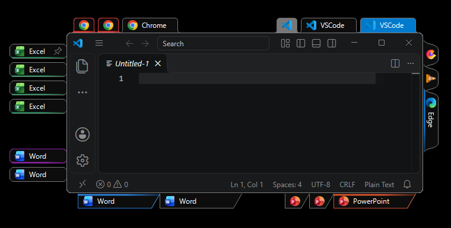

https://github.com/user-attachments/assets/ecd3a032-ba45-427c-9eef-5b80f7664a28

WindowTabs brings windows from different apps together in a tabbed interface on Windows.

<details>
<summary>Read more about WindowTabs and the goals behind its development</summary>

### I'd like WindowTabs to greatly enhance how you use Windows

WindowTabs is a tool that greatly enhances Windows productivity.

In an era when smartphones and tablets can handle web browsing and entertainment, using a Windows PC probably means you're doing some kind of creative work: accounting, customer support, presentations, business management, legal paperwork, electronic medical records, video editing, illustration, or software development.

If that describes your daily work and you want Windows to be easier to use, I really hope WindowTabs can help you work more comfortably and efficiently. I've developed its features over many versions with those needs in mind.

### Why a tab UI?

As you can feel from using a browser every day, a tabbed interface is intuitive and comfortable.

WindowTabs brings that same ease of use to windows across your desktop. Once you try it, I think you'll appreciate how much it helps you get work done. Switching between windows takes less effort, leaving you free to focus on the task at hand.

### Microsoft once prototyped a Windows-wide tab UI, but the project was abandoned

Microsoft once aimed to bring tabbed management to all windows through an experimental Windows feature called **Sets**.
It was discontinued. Perhaps integrating it into the OS while preserving backward compatibility proved too difficult, causing errors and bugs, and the benefits were judged too small for the complexity.

Although the project fell through, I think its vision was wonderful.
WindowTabs provides an excellent tabbed interface for almost any window without being built into the OS itself.
Using WindowTabs every day shows me just how comfortable switching and managing windows can be, and how much it helps me work efficiently.

### What's enhanced in the Standard-Software edition

In addition to managing windows with tabs on their top, bottom, left, and right edges, the Standard-Software edition of WindowTabs lets you snap windows to any screen edge or move them to another display in one action. Its snapping features go beyond those built into Windows. There is no need for long-distance dragging and dropping, which is particularly useful with multiple displays.

### About me (satoshi-yamamoto, the author of the Standard-Software edition)

I've been a paid user of WindowTabs since before it was open-sourced, and I've always loved its tabbed interface. Having used many similar tools, I know this way of working thoroughly, and I think I know tabbed interfaces very well.

I've long hoped this way of working would reach more people and help everyone work more efficiently.
So I'm delighted to have the opportunity to improve WindowTabs as open source and share my ideas about how it should work and feel with others.

I keep improving WindowTabs little by little, asking myself: "How can I make working with windows more efficient for more people — in other words, how can I help more people get their work done faster?"

So far, I'm happy to have built and shared something with a wide range of features that work reliably.

### How to use it

Everyone uses Windows differently, so I imagine each person will find their own useful ways to use WindowTabs. Here are some typical examples:

- Operate Chrome, Edge, and Firefox — along with each one's incognito / private windows — all as a single browser window.
- Manage multiple Excel windows, or multiple Word and PowerPoint windows, as a single office app window.

I (satoshi-yamamoto) am a software developer; in my day job I build web applications. I've built things like a browser-based drawing tool, an in-browser car navigation app, and business chat tools.

I group multiple VSCode, Visual Studio, Terminal, WinMerge, file explorer, image viewer, Excel, and browser windows with WindowTabs, snapping them to the left and right of each display. Even apps with their own tabs can be managed at the window level, creating multiple levels of tab organization. This lets me manage a great many windows with little effort.

### I'd be truly happy if you'd recommend it to people around you

If you know someone who works by switching between lots of windows, I'd be delighted if you'd suggest, "Why not give WindowTabs a try?" Some of its convenience only becomes clear when you use it yourself.

I'm building this primarily because I want it for myself. But if it can be useful to others and bring even a small positive impact to their work, that would make me very happy as a software developer. My thanks go to all of you who use it.

If you have any feedback, I'd love to hear it on GitHub Issues.

</details>

## Download

Supported: Windows 10 / Windows 11  
Latest version: ss_2026.11.06_next1 · [Release notes version.md](version.md)

<a href="https://github.com/standard-software/WindowTabs/releases"></a>

[Download a release](https://github.com/standard-software/WindowTabs/releases)

- **WtSetup.msi**: follow the installer (default: `Program Files\WindowTabs`).
- **WindowTabs.zip**: extract and run `WindowTabs.exe`. For settings you can carry with you, see [Settings files and portable use](#settings-files-and-portable-use).

## Getting started

Right-click the tray icon → Settings → Programs to choose which apps get tabs. Right-click a tab for its commands.

Auto Grouping brings windows of the same app together; shared categories (1–10) group different apps. Enabling either also groups open windows; tabs you detach afterwards stay separate.

## Working with tabs

### Select and move several tabs

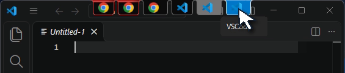

Ctrl-click to select or deselect; Shift-click to select a range. Menu commands also apply to the selection.

### Detach and arrange tabs

| Before | After |
| --- | --- |
| 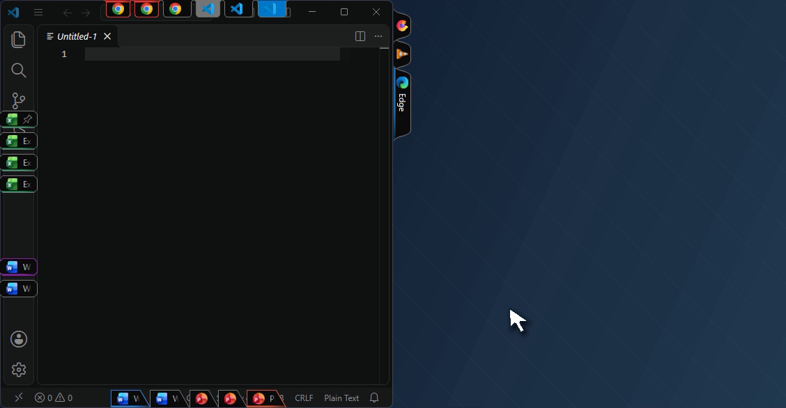 | 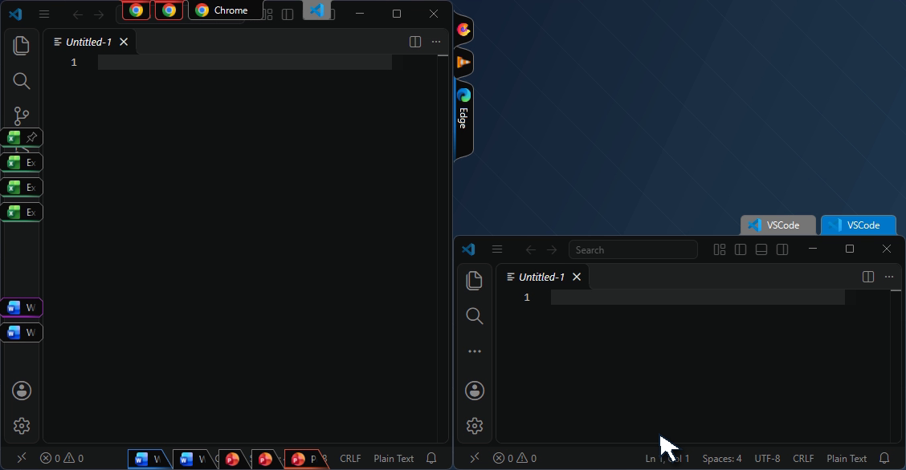 |

Detach selected tabs and place them at a chosen position. Drag tabs to reorder, detach, or join another group.

### Switch between tabs on all four edges

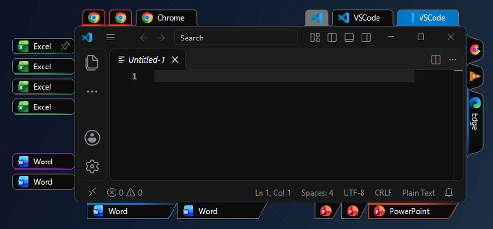

Switch apps using tabs on any of the four edges. Choose which edges to use in Settings → Tabs.

### Snap windows into position

| Choose from the menu | Result |
| --- | --- |
| 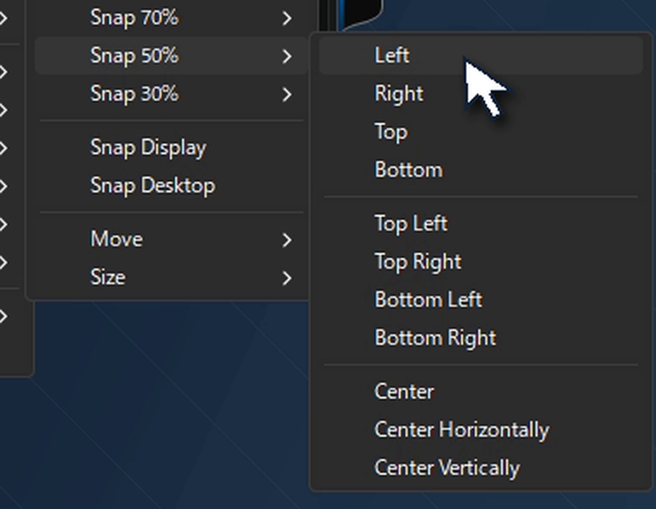 | 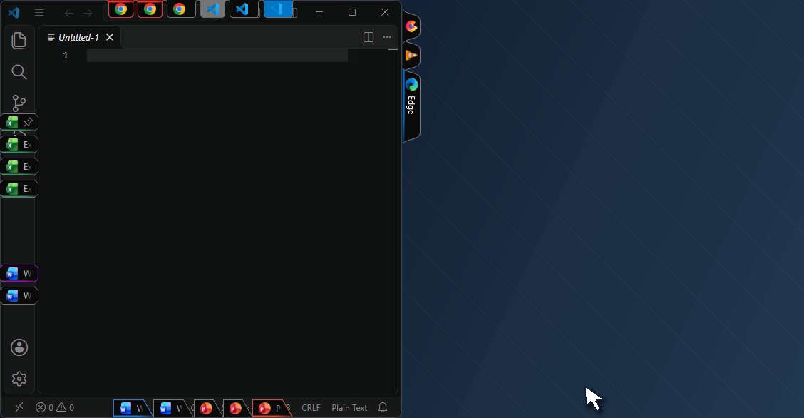 |

Place windows at screen edges or corners, choose a percentage size, or move them to another display. Ordinary snaps preserve size; percentage snaps resize relative to the display.

### Join tab groups

| Before | After |
| --- | --- |
| 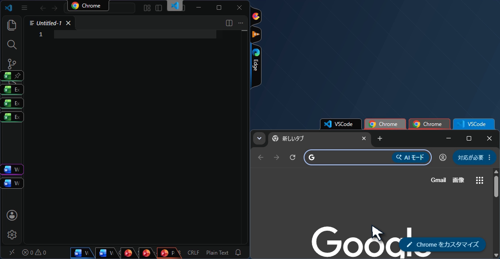 | 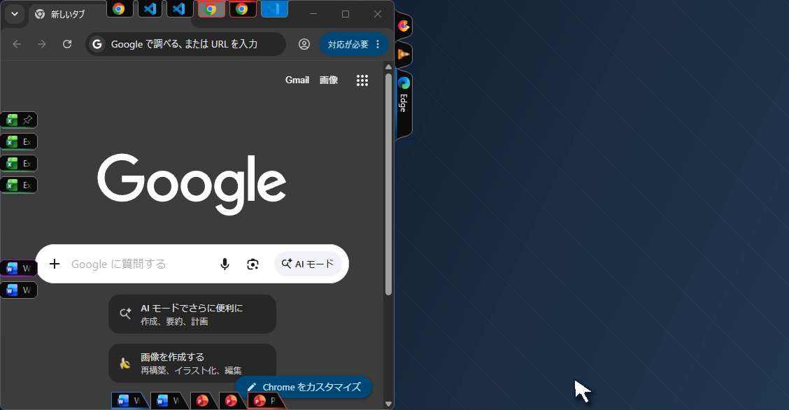 |

Join an entire group to another group, including one on another virtual desktop.

### Align tabs

| Before | After |
| --- | --- |
|  | 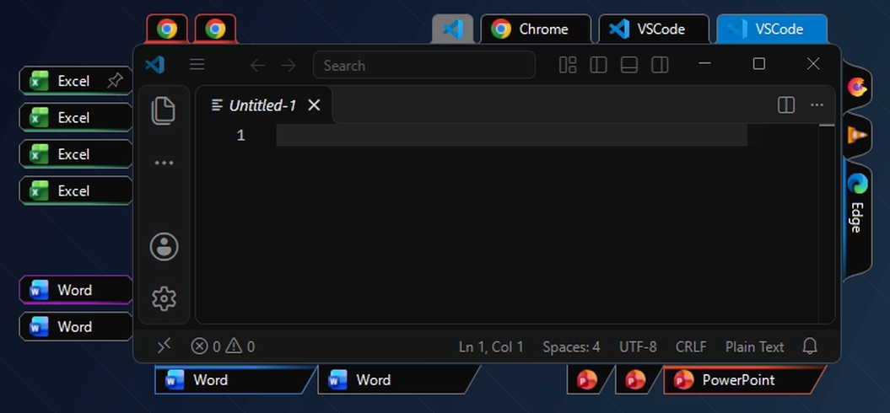 |

Align individual tabs, selected tabs, or all tabs on an edge. Left and right edges use top and bottom alignment.

### Move tabs to another edge

| Before | After |
| --- | --- |
| 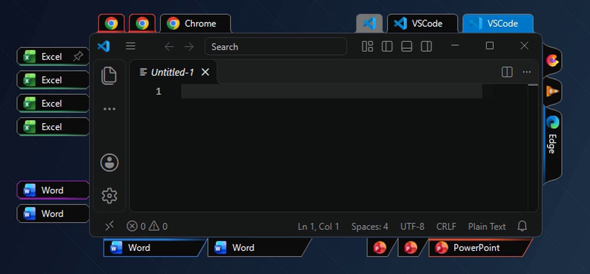 | 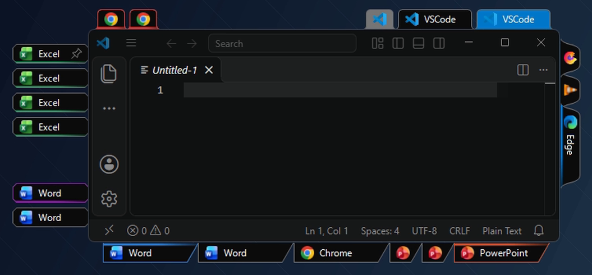 |

Move individual tabs, selected tabs, all tabs on an edge, or a whole group to an enabled edge. Alignment and pinning are preserved.

### Identify tabs by color

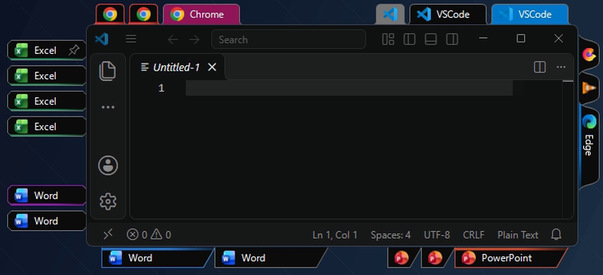

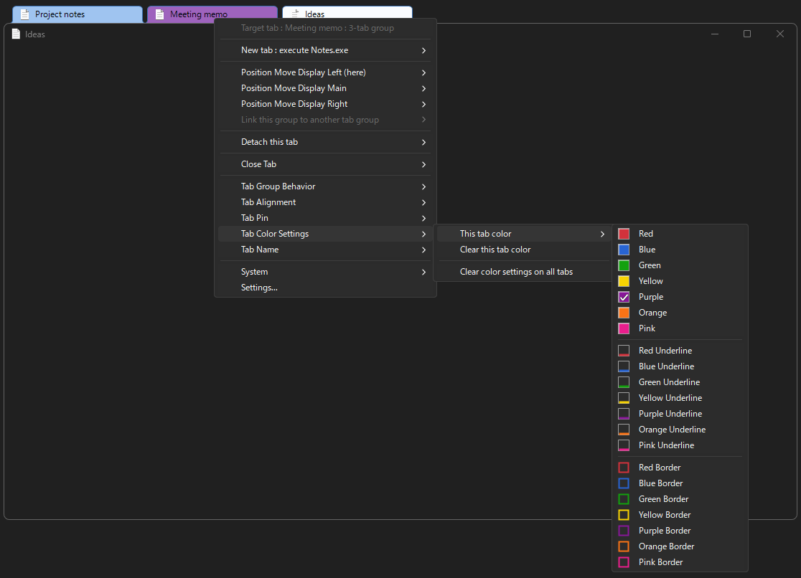

Color-code tabs with backgrounds, underlines, or borders.

### More tab commands

Pin tabs to show just an icon or use a fixed width. Right-click to rename tabs, launch another instance of the same app, or close tabs on an edge or throughout the group.

## Customize appearance and controls

### Style and size for each edge

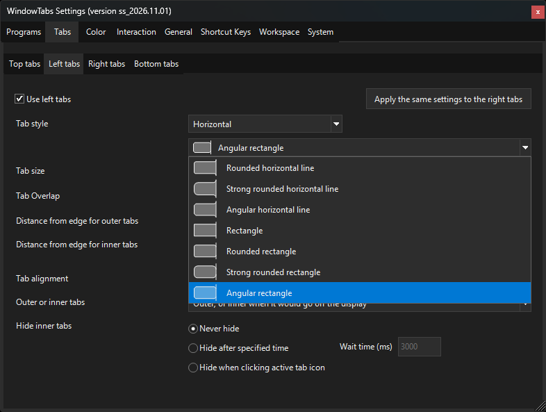

Set styles, sizes, and alignment separately for each edge. Side tabs support vertical or horizontal text, and changes apply without restarting.

### Dark mode and color themes

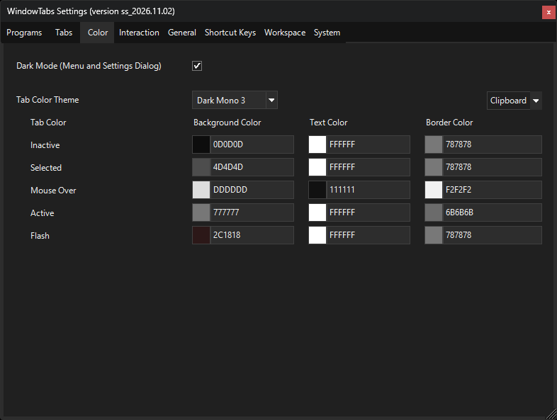

Edit and save themes, and share them through the clipboard. You can also submit themes through [Issues](https://github.com/standard-software/WindowTabs/issues).

### Buttons and movement

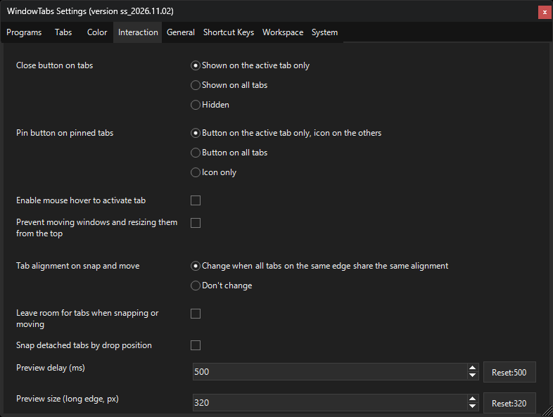

The movement lock blocks title-bar dragging and resizing from the top; resizing from the sides and bottom remains available.

### Startup and tab visibility

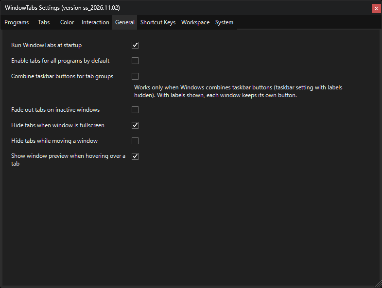

Fade inactive groups, or hide tabs while a window is fullscreen or being moved.

### Keyboard shortcuts

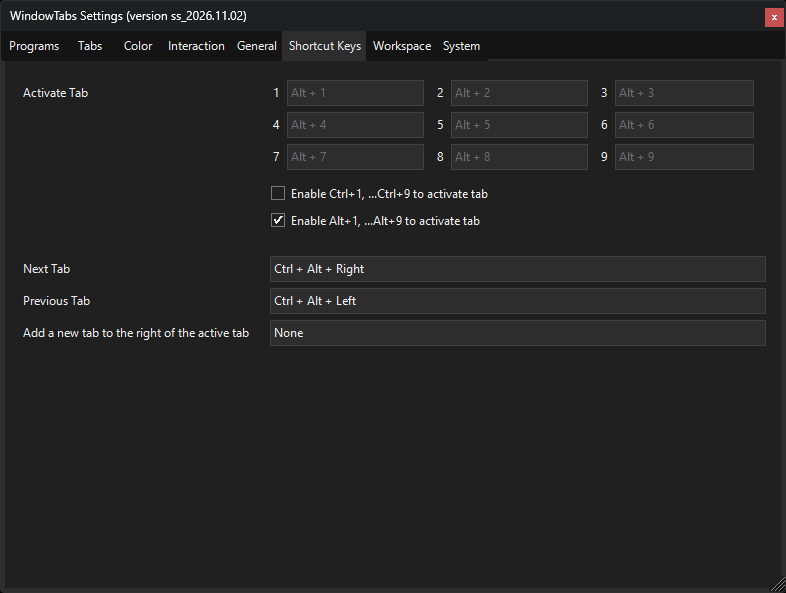

Numbered tab shortcuts are active only while working in a target window.

## Saving and restoring

Tab groups are saved every 10 seconds and restored after WindowTabs or Windows restarts. Workspaces let you save and recall layouts, decorations, pins, names, and alignment.

<details>
<summary>Restore behavior and virtual desktops</summary>

- Reopened windows are matched by app and title. If a title is not yet final, restoration waits for it. Records are kept for 30 days for unopened windows and 8 days for manually closed tabs.
- A group spans virtual desktops. Tabs on another desktop are dimmed; clicking one switches desktops. Groups with no windows on the current desktop are hidden.
- New workspaces can save tabs on the current desktop or all desktops. Restoring does not move windows between desktops. Joining groups does not switch desktops either.
- If WindowTabs becomes unresponsive, Watchdog restarts it and restores tab groups.

</details>

## Settings files and portable use

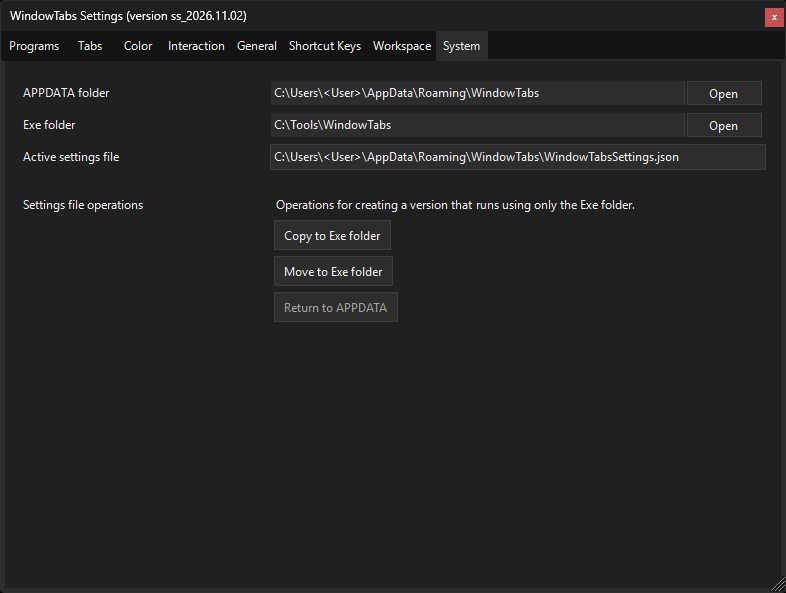

Settings are saved in `%APPDATA%\WindowTabs\WindowTabsSettings.json`. If absent, WindowTabs uses `WindowTabsSettings.json` beside the exe. The System tab shows the active file and lets you copy or move it to the exe folder, or return it to APPDATA.

<details>
<summary>Backups, overrides, and migration</summary>

- The latest 10 backups are kept in `%APPDATA%\WindowTabs\`, including backups of portable settings.
- Bundled `Settings\` files are overwritten on updates. Place same-named files in `%APPDATA%\WindowTabs\Settings\` for per-key overrides.
- `VersionFolder.json`: for listed executables, ignores path folders containing only digits and dots so updates retain app settings. Store apps are handled automatically.
- `FramelessWindow.json`: include apps with custom frames using `"example.exe": true`. Specify invisible margins as `"example.exe": { "left": 26, "top": 23, "right": 26, "bottom": 29 }` (pixels at 100% scaling).
- Override translations by putting only changed keys in same-named files under `Settings\Language\`. To add a language, provide its file and `FileList.json`. `FileList.json` replaces the entire language list.
- Old `WindowTabsSettings.txt` files are copied to JSON on first launch. The old file remains but receives no later changes. Move edits from the old `Language\` folder to the user override folder above.
- Old `Window_Margin.json` / `WindowMargin.json` files are no longer needed. MSI removes old files beside the exe; ZIP leaves them. Files in APPDATA remain. Leftover files are harmless.

</details>

## Compatibility and everyday controls

- Supports multiple displays with different scaling levels. UWP apps are treated together as one executable for tabs and auto grouping.
- Use the tray menu to change language, temporarily disable tabs, or check for updates. Language changes need no restart.
- Updates are checked only when requested. Updating launches the MSI installer or replaces the ZIP executable and restarts it.

<details>
<summary>Supported languages</summary>

English, Japanese (including Kansai and Tohoku dialect files), Chinese (Simplified and Traditional), Korean, French, German, Italian, Spanish, Portuguese, Turkish, Polish, Vietnamese, and Indonesian.

</details>

## Tab Context Menu

<details>
<summary>Details</summary>

```
Target tab : (tab name) : (N)-tab group — a display-only caption showing which tab the menu acts on and the size of its tab group (not selectable)
---
New tab : execute (exe name)
  Right of this tab
  ---
  Position (same submenu as "Position Move")
  ---
  Link to another tab group
---
Position Move
  Snap Left / Snap Right / Snap Top / Snap Bottom
  ---
  Snap 90% / 70% / 50% / 30% (each)
    Left / Right / Top / Bottom
    Top Left / Top Right / Bottom Left / Bottom Right
    Center / Center Horizontally / Center Vertically
  ---
  Snap Display
  Snap Desktop (multi-monitor only)
  ---
  Move
    Left Edge / Right Edge / Top Edge / Bottom Edge
    Top Left / Top Right / Bottom Left / Bottom Right
Link this group to another tab group (submenu lists the tab groups to link to)
---
Detach this tab
  Position (same submenu as "Position Move")
  ---
  Link to another tab group
---
Close Tab
  Close this tab
  ---
  Close {N} tabs to the left
  Close {N} tabs to the right
  ---
  Close all top tabs except this one ({N})
  Close all top tabs ({N}) (uses the clicked tab’s edge)
  Close all tabs ({N})
---
Tab Group Behavior
  Prevent moving windows and resizing them from the top
  Leave room for tabs when snapping or moving
Tab Alignment
  Align this tab to Left
  Align this tab to Right
  ---
  Align all top tabs to the left
  Align all top tabs to the right
Tab Direction
  Change the direction of this tab (or Change the direction of {N} selected tabs)
    Top tabs / Left tabs / Right tabs / Bottom tabs
  Change the direction of all top tabs (uses the clicked tab’s edge)
    Top tabs / Left tabs / Right tabs / Bottom tabs
  Change the direction of all tabs
    Top tabs / Left tabs / Right tabs / Bottom tabs
Tab Pin
  Pin this tab
  Unpin this tab
  ---
  Pin all top tabs (uses the clicked tab’s edge)
  Unpin all top tabs
  ---
  Pin all tabs
  Unpin all tabs
Tab Color Settings
  This tab color
    Red / Blue / Green / Yellow / Purple / Orange / Pink
    ---
    (same 7 colors, Underline variants)
    ---
    (same 7 colors, Border variants)
  Clear this tab color
  ---
  Clear color settings on all tabs
Tab Name
  Rename this tab : (tab name)
  Reset this tab name : (name after reset)
---
System
  Copy (exe name) path
  Copy window title : (window title)
  ---
  Open folder of (exe name)
  Force kill this process
Settings...
```

In multi-select, per-tab items show "Selected {N} tabs...". When the tab you right-clicked is not in the selection, they read "Selected {N} tabs + target tab...".

</details>

## Acknowledgments

This Standard-Software edition is forked from payaneco's repository and incorporates some code implementations from leafOfTree's version. Maintained by [Satoshi Yamamoto (@standard-software)](https://github.com/standard-software).

<details>
<summary>Read more about the project history and the lineage of forks</summary>

WindowTabs was originally developed by Maurice Flanagan in 2009 and was offered as both free and paid editions at the time. The original author has since open-sourced it.

- https://github.com/mauricef/WindowTabs (404 Not Found)

Mr./Ms. redgis forked it and migrated to VS2017 / .NET 4.0.

- https://github.com/redgis/WindowTabs

Mr./Ms. medlir hosts the source code.
- https://github.com/medlir/WindowTabs

Looking at the commit log, Mossy Flanagan made the early commits.
- https://github.com/mossy-xyz

Mr./Ms. payaneco forked medlir/WindowTabs's source code.
- https://github.com/payaneco/WindowTabs
- https://github.com/payaneco/WindowTabs/network/members
- https://ja.stackoverflow.com/a/53822

Mr./Ms. leafOfTree also created a fork with various improvements:
- https://github.com/leafOfTree/WindowTabs
- https://github.com/leafOfTree/WindowTabs/network/members

</details>

## Building from Source

<details>
<summary>Details</summary>

### Prerequisites

- Visual Studio 2026 Community Edition
- WiX Toolset v3.11 or newer (for building the MSI installer)

### Build Scripts

**build_release.bat** in the project root builds both the MSI installer and the portable ZIP distribution.

- Output: `exe\installer\WtSetup.msi`, `exe\zip\WindowTabs.zip`

</details>

## Links

<details>
<summary>Details</summary>

### English Resources

- WindowTabs - Download  
  https://www.softpedia.com/get/Desktop-Enhancements/ssWindowTabs.shtml

### Japanese Resources

- WindowTabs のダウンロード・使い方 - フリーソフト100  
  https://freesoft-100.com/review/windowtabs.html

- どんなウィンドウもタブにまとめられる「WindowTabs」に日本語派生プロジェクトが誕生（窓の杜） - Yahoo!ニュース  
  https://news.yahoo.co.jp/articles/523e4c5b9db424bb1edfc582d647c1624a9b7502 (404 Not Found)

- どんなウィンドウもタブにまとめられる「WindowTabs」に日本語派生プロジェクトが誕生 - 窓の杜  
  https://forest.watch.impress.co.jp/docs/news/2067165.html

- WindowTabs のダウンロードと使い方 - ｋ本的に無料ソフト・フリーソフト  
  https://www.gigafree.net/utility/window/WindowTabs.html

- C# - WindowTabs というオープンソースを改良してみたいのですがビルドができません。何か必要なものがありますか？ - スタック・オーバーフロー  
  https://ja.stackoverflow.com/questions/53770/windowtabs-というオープンソースを改良してみたいのですがビルドができません-何か必要なものがありますか

- 全Windowタブ化。Setsで頓挫した夢の操作性をオープンソースのWindowTabsで再現する。 #Windows - Qiita  
  https://qiita.com/standard-software/items/dd25270fa3895365fced

</details>

## Code signing policy

Free code signing provided by [SignPath.io](https://about.signpath.io), certificate by [SignPath Foundation](https://signpath.org).

- Committers and reviewers: [standard-software](https://github.com/standard-software)
- Approvers: [standard-software](https://github.com/standard-software)

Releases up to ss_2026.11.06 are not signed.

### Privacy policy

This program will not transfer any information to other networked systems unless specifically requested by the user or the person installing or operating it.

## License

This project is open source and licensed under the MIT License.

## Comments

If you have any issues, please contact us via GitHub Issues or email: `standard.software.net@gmail.com`

Issues are the quicker way to reach me.
