# WindowTabs <br>(Standard-Software edition)

**Language:** [English](README.md)

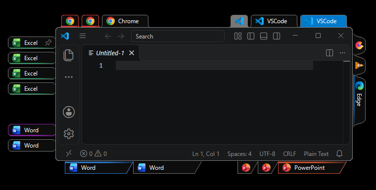

https://github.com/user-attachments/assets/ecd3a032-ba45-427c-9eef-5b80f7664a28

WindowTabs は、さまざまなアプリのウィンドウをタブでまとめて操作する Windows 用ツールです。

<details>
<summary>WindowTabs の説明、開発の意図、など詳しく読む</summary>

### WindowTabs で Windows の操作性を大きく高めていただきたいです。

WindowTabs は Windows の操作性を大きく高めるツールです。

スマートフォンやタブレット端末でブラウザ閲覧やエンターテイメントを楽しめる時代に、みなさんは、Windows PC を使っているということは、それは何か創造的な作業をされているんだと思います。例えば、経理、お客様対応、プレゼン作成、経営管理、法的事務、医療業務の電子カルテ操作、動画編集、イラスト作成、あるいはソフトウェア開発、など。

そのような作業を日々行っていて Windows の操作性を向上させたいと思っている方にこそ、WindowTabsを使って操作性と作業効率を高めていただきたいと思っています。そのようなニーズに応えられるような機能を作りこんでバージョンを重ねてきました。

### なぜタブUIなのか

ブラウザを日々使っていると感じるように、タブUIは非常に直感的で人間に心地のよいUIです。

WindowTabs を導入することでブラウザと同様の操作性を Windows にもたらします。使っていただけると、とても便利です。てきぱきと仕事をこなすために重要な操作性と感じられると思います。目的の作業を行うためにウィンドウをいろいろ切り替えると思いますが、その際の操作コストが下がり目的に集中することができます。

### Windows全体のタブUIは、以前に Microsoft が試作し頓挫しました。

Microsoft も、何年も前に Windows の OS の機能拡張の試作として Sets という機能で、ウィンドウのすべてをタブ管理することを目指していたことがありました。
が、中止になっています。Windows OS 自体の内部に組み込むには過去の互換性などで難しすぎてエラーが出たり不具合がでたりするので、複雑さのわりにメリットが薄いと判断された、ということなのかもしれません。

頓挫してしまいましたが、その目指す方向は素晴らしいです。
WindowTabs は、OS の内部には組み込まれない形で、ほとんどどのようなウィンドウでもタブ化できるという優れたタブUIを実現しています。
WindowTabsを日常で使っていると、快適にウィンドウの切り替えや管理ができて作業効率があがります。

### Standard-Software edition の強化点

WindowTabs Standard-Software edition では、ウィンドウの上下左右に配置したタブでの管理に加えて、上下左右へのスナップや別ディスプレイへの移動を1アクションで実行できます。Windows 標準のスナップ機能よりもより多くの機能を持つスナップ機能をもたせています。長い距離のドラッグ＆ドロップも不要で、特にマルチディスプレイ環境で便利です。

### Standard-Software edition の作者の私 satoshi-yamamoto について

私は WindowTabs がオープンソースになる前から WindowTabs の有料ユーザーでタブUIをとても気に入って使っていました。さまざまな同種のソフトウェアも使いましたので、この操作性について熟知していて、タブUIについて、とても詳しい人物だと思います。

昔から、この操作性が多くの人に広がってくれたら、みんなが操作効率高まってうれしいなと思っていました。
今、オープンソースで WindowTabs を改良することができ、自分の考えた操作性、操作感を、他の方に届けることができる機会が得られたことは、とても嬉しいです。

「より多くの方へ効率よい操作性を提供するにはどうしたらいいか、言い換えると、どうすれば多くの方がより仕事を素早く完了させるようにできるだろうか」ということを考えて、WindowTabs を少しずつ改善していっています。

今のところ、かなりうまく高機能で動作精度もよいものができて、それを提供できてうれしいです。

### 使い方

個人個人のユーザーの Windows の使い方が様々であるように、ユーザーひとりひとりに WindowTabs の便利な使い方がありそうな気はしますが、代表的には次のような使い方がありそうです。

- Chrome と Edge と Firefox、そしてそれぞれのシークレットモード/プライベートモードのウィンドウを、すべて1つのブラウザウィンドウとして操作する
- 複数のExcel、複数のWordやPowerPointを1つのオフィスアプリのウィンドウとして管理する。

私(satoshi-yamamoto)はソフトウェア開発者で、普段の仕事ではWebアプリケーションを作っています。ブラウザで絵をかいたりするツールや、ブラウザで動くカーナビや、ビジネスチャットツールを作ってきました。

私は複数の VSCode、Visual Studio、Terminal、WinMerge、ファイラー、画像ビューワー、Excel、ブラウザを WindowTabs でまとめ、各ディスプレイの左右にスナップしています。アプリケーションがタブUIを備えてあっても、それをウィンドウ単位で管理できるので、タブの多段階管理を行っているように使いこなしています。非常に多くのウィンドウを苦労なく管理することができます。

### まわりの方にも勧めていただけたら、うれしいです

たくさんのウィンドウを切り替えて作業する方がいたら、ぜひ「WindowTabs を使ってみたら？」と勧めていただけたら嬉しいです。使って初めて分かる便利さがあります。

私は、自分が使いたいから作っているだけではあるのですが、それでも他の人の役に立てて、少しでもいい影響を届けることができれば、ソフトウェア開発者として非常にうれしいです。使ってくださっているユーザーの皆様に感謝しています。

何かご意見ありましたら、GitHub Issues に投稿いただけますとうれしいです。

</details>

## ダウンロード

対応: Windows 10 / Windows 11  
最新バージョン: ss_2026.11.06_next1 · [変更履歴 version_Japanese.md](version_Japanese.md)

<a href="https://github.com/standard-software/WindowTabs/releases"></a>

[リリースページからダウンロード](https://github.com/standard-software/WindowTabs/releases)

- **WtSetup.msi**：インストーラーに従ってインストール（既定：`Program Files\WindowTabs`）。
- **WindowTabs.zip**：展開して `WindowTabs.exe` を実行。持ち運ぶ設定は [設定ファイルとポータブル利用](#設定ファイルとポータブル利用) を参照。

## 使い始める

トレイアイコンを右クリック →「設定」→「プログラム」でタブ化するアプリを選びます。タブの右クリックで各種操作ができます。

自動グループ化で同じアプリを、同じカテゴリー（1〜10）で異なるアプリをまとめられます。有効にすると開いているウィンドウもまとまり、その後に手で分離したタブは外に残ります。

## タブで操作する

### 複数選択して一緒に動かす

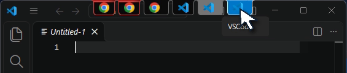

Ctrl + クリックで選択・解除、Shift + クリックで範囲選択。メニュー操作も選択したタブに適用されます。

### タブを分離して並べる

| 分離前 | 分離後 |
| --- | --- |
| 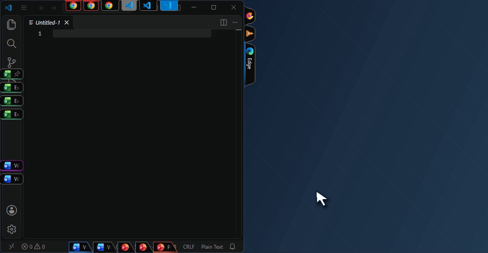 | 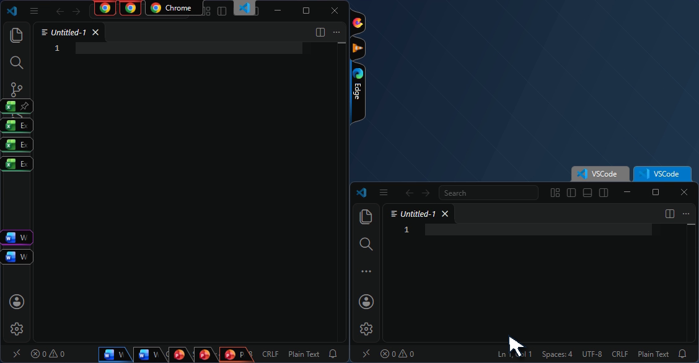 |

選択したタブを分離し、指定位置へ配置できます。ドラッグでは並べ替え・分離・別グループへの連結もできます。

### 上下左右のタブを切り替える

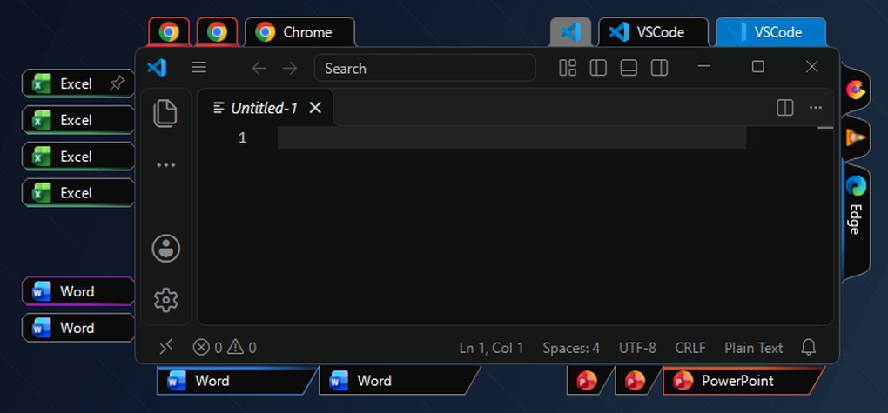

四辺に置いたタブでアプリを切り替えられます。使う辺は設定の「タブ」で選びます。

### ウィンドウをスナップする

| メニューで指定 | 配置後 |
| --- | --- |
| 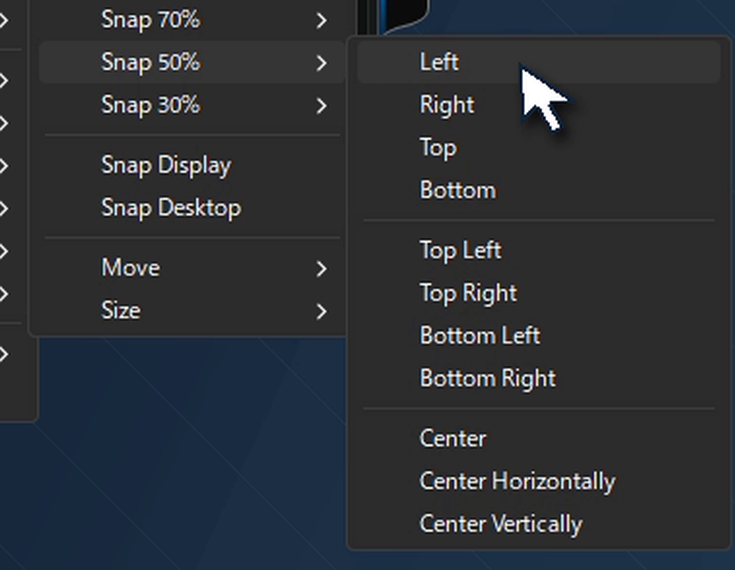 | 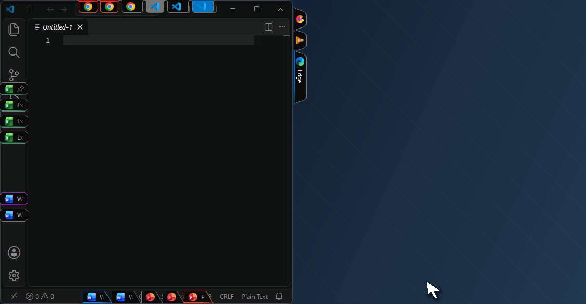 |

画面端・四隅への配置、比率指定、別ディスプレイへの移動ができます。通常のスナップは大きさを維持し、% 指定はディスプレイに対する比率でサイズを変えます。

### グループを連結する

| 連結前 | 連結後 |
| --- | --- |
| 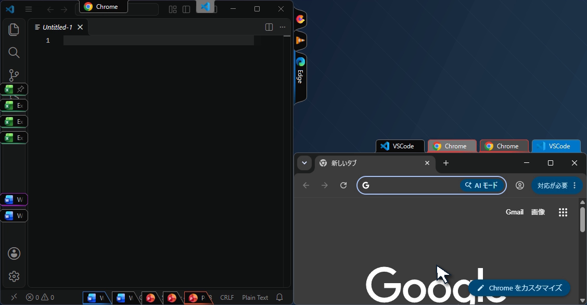 | 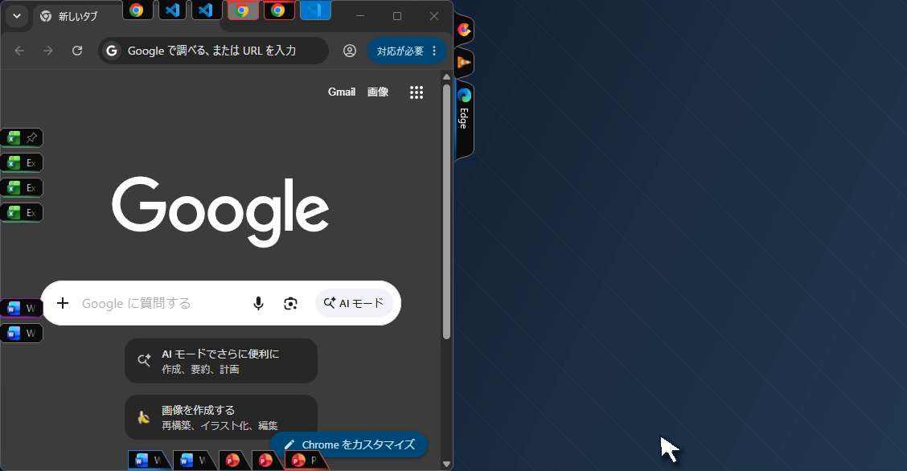 |

グループ全体を別のグループへ連結できます。他の仮想デスクトップのグループも選べます。

### タブを左右に寄せる

| 寄せる前 | 寄せた後 |
| --- | --- |
|  | 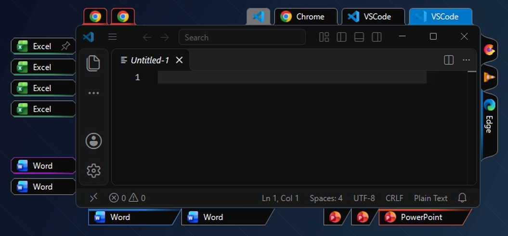 |

タブごと・選択したタブ・同じ辺の全タブをまとめて配置できます。左右の辺では上寄せ・下寄せになります。

### タブを別の辺へ移す

| 移す前 | 移した後 |
| --- | --- |
| 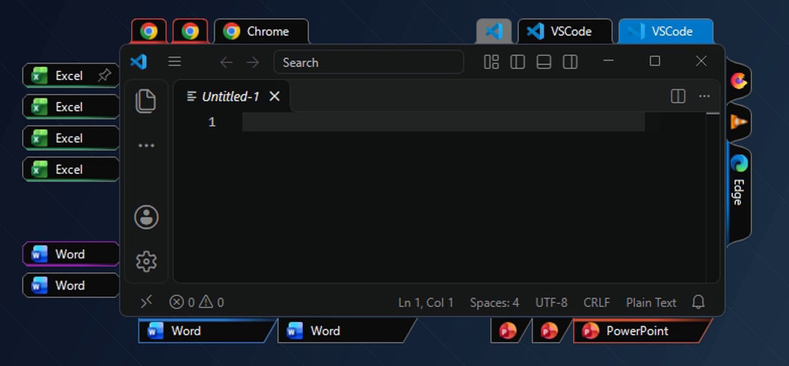 | 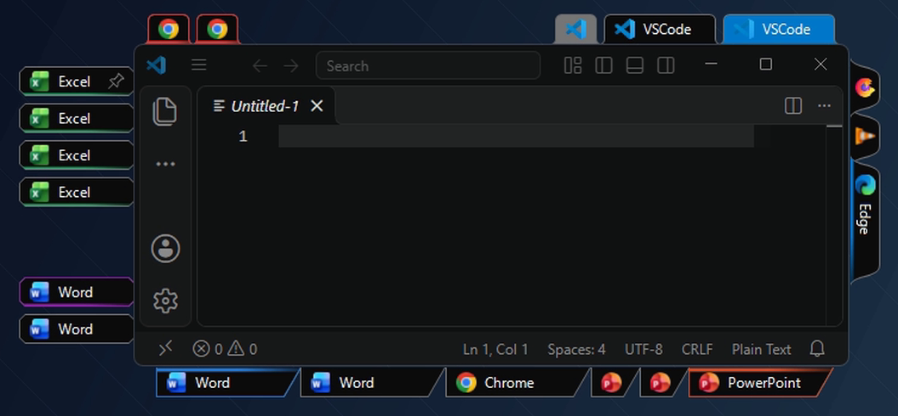 |

タブごと・選択したタブ・同じ辺の全タブ・グループ全体を、使用中の辺へ移せます。寄せとピン止めは維持されます。

### 色で見分ける

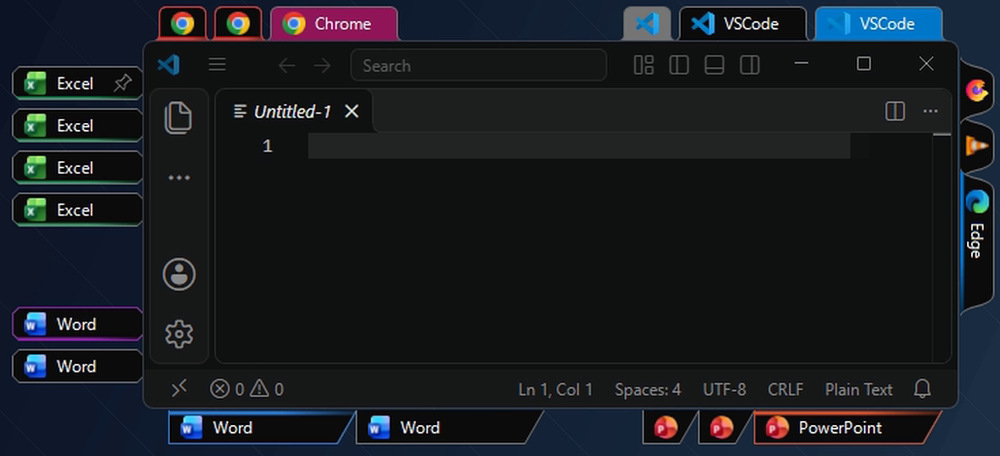

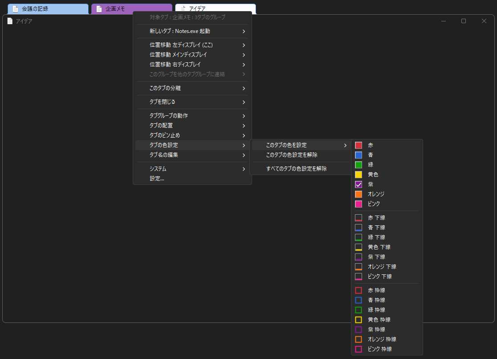

背景・下線・枠線で色分けできます。

### その他のタブ操作

ピン止めでアイコンのみ、または指定幅のタブにできます。右クリックからタブ名の変更、同じアプリの新規起動、同じ辺やグループ全体のタブを閉じる操作もできます。

## 見た目と操作を変える

### 四辺のスタイルと大きさ

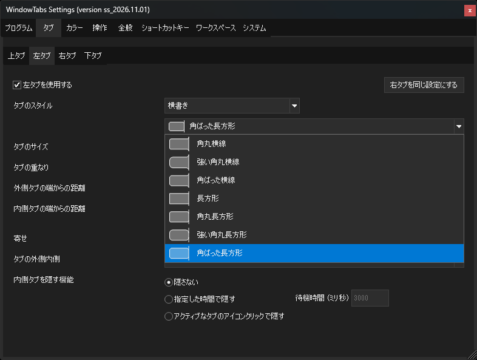

四辺それぞれにスタイル・大きさ・寄せを設定できます。左右のタブは縦書きと横書きを選べ、変更は再起動なしで反映されます。

### ダークモードとカラーテーマ

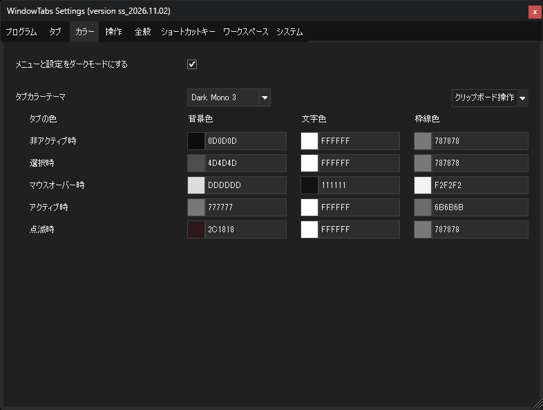

テーマは編集・保存し、クリップボードで共有できます。作成したテーマは [Issues](https://github.com/standard-software/WindowTabs/issues) にもお寄せください。

### ボタンと移動の動作

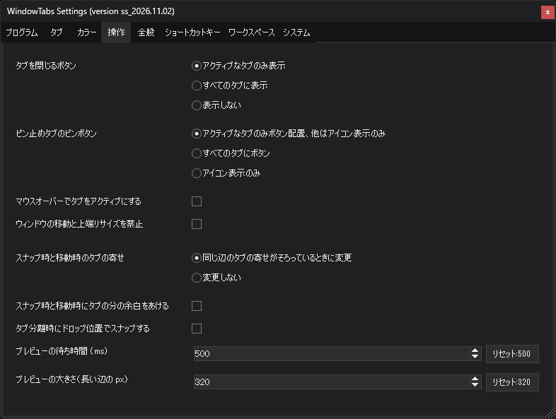

移動禁止はタイトルバーのドラッグと上端リサイズが対象です。左右・下端のリサイズはできます。

### 起動とタブの表示

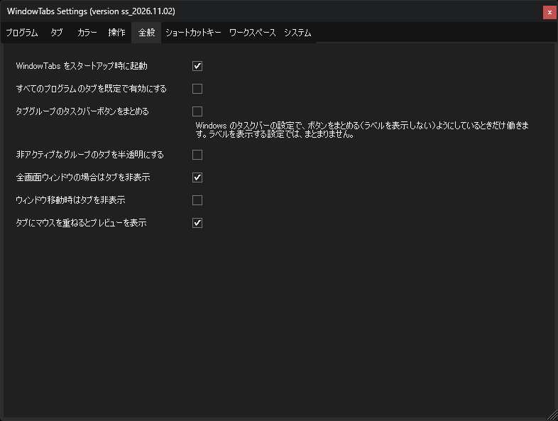

非アクティブなグループを半透明にしたり、全画面表示中・移動中のタブを隠したりできます。

### ショートカットキー

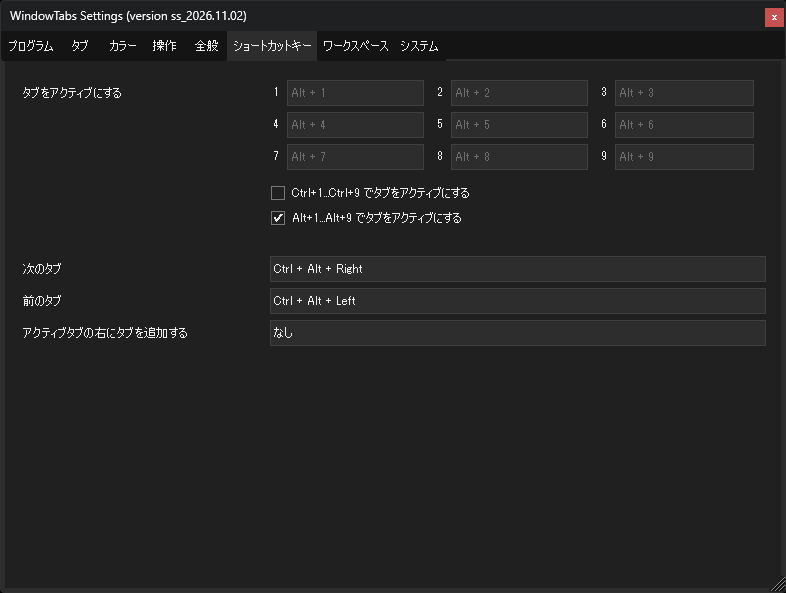

数字キーによるタブ選択は、対象ウィンドウの操作中のみ有効です。

## 保存と復元

タブグループは10秒ごとに保存され、WindowTabs や Windows の再起動後も復元されます。「ワークスペース」では配置・装飾・ピン・名前・寄せを保存して呼び出せます。

<details>
<summary>復元の条件と仮想デスクトップ</summary>

- 再び開かれたウィンドウをアプリとタイトルで照合します。タイトルが確定していない場合は、確定後に戻ります。未再開の情報は30日、手で閉じたタブの情報は8日保持します。
- グループは仮想デスクトップをまたいで1つです。別デスクトップのタブは半透明で、クリックすると切り替わります。現在のデスクトップにウィンドウがないグループは表示しません。
- ワークスペースの新規保存は、現在またはすべてのデスクトップのタブを対象にできます。復元はウィンドウを別デスクトップへ移しません。グループ連結もデスクトップを切り替えません。
- 無応答時は Watchdog が WindowTabs を再起動し、タブグループを復元します。

</details>

## 設定ファイルとポータブル利用

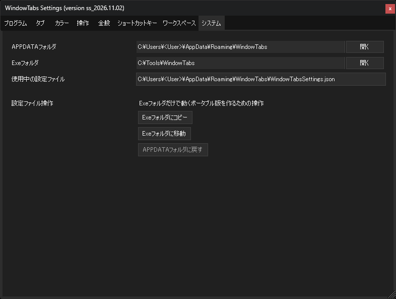

設定は `%APPDATA%\WindowTabs\WindowTabsSettings.json` に保存します。このファイルがない場合は exe と同じ場所の `WindowTabsSettings.json` を使います。「システム」で使用中のファイルを確認し、Exeフォルダへのコピー・移動や APPDATA へ戻す操作ができます。

<details>
<summary>バックアップ・追加設定・旧版からの移行</summary>

- バックアップは `%APPDATA%\WindowTabs\` に最新10個を保存します。ポータブル設定のバックアップもここに保存します。
- 同梱の `Settings\` は更新で上書きされます。カスタマイズは `%APPDATA%\WindowTabs\Settings\` の同名ファイルに置くと項目単位で優先されます。
- `VersionFolder.json`：指定した exe のパスで数字とドットだけのフォルダを無視し、更新後も同じアプリとして扱います。Store アプリは自動対応です。
- `FramelessWindow.json`：独自の枠を持つアプリを `"example.exe": true` で対象にできます。見えない余白は `"example.exe": { "left": 26, "top": 23, "right": 26, "bottom": 29 }` の形式で指定します（拡大率100%のピクセル）。
- 翻訳の修正は `Settings\Language\` 内の同名ファイルに変更するキーだけを書きます。言語を追加するときは言語ファイルと `FileList.json` を置きます。`FileList.json` は一覧全体を置き換えます。
- 旧 `WindowTabsSettings.txt` は初回起動時に JSON へコピーされます。旧ファイルは残りますが、以後の変更は反映されません。旧 `Language\` の編集内容は上記のユーザー用フォルダへ移してください。
- 旧 `Window_Margin.json` / `WindowMargin.json` は不要です。exe 側の旧ファイルは MSI では削除、ZIP では残り、APPDATA 側は残ります。残っていても害はありません。

</details>

## 対応環境と日常の操作

- 異なる拡大率のマルチディスプレイに対応。UWP アプリは全体を1つの exe としてタブ化・自動グループ化します。
- トレイメニューで言語変更、一時無効化、最新版の確認ができます。言語変更は再起動不要です。
- 更新確認はクリックしたときだけ行います。更新時は MSI 版ではインストーラー、ZIP 版では exe の置き換えと再起動を行います。

<details>
<summary>対応言語</summary>

英語、日本語（関西弁・東北弁版も同梱）、中国語（簡体・繁体）、韓国語、フランス語、ドイツ語、イタリア語、スペイン語、ポルトガル語、トルコ語、ポーランド語、ベトナム語、インドネシア語。

</details>

## タブメニューの内容

<details>
<summary>詳細</summary>

```
対象タブ : (タブ名) : (N)タブのグループ — メニューの対象タブとタブグループのタブ数を示す表示専用の項目 (選択不可)
---
新しいタブ : (exe名) 起動
  このタブの右
  ---
  位置指定 (「位置移動」と同じサブメニュー)
  ---
  他のタブグループに連結
---
位置移動
  左スナップ / 右スナップ / 上スナップ / 下スナップ
  ---
  スナップ 90% / 70% / 50% / 30% それぞれ
    左 / 右 / 上 / 下
    左上 / 右上 / 左下 / 右下
    中央 / 水平方向に中央 / 垂直方向に中央
  ---
  スナップ ディスプレイ全体
  スナップ デスクトップ全体 (マルチディスプレイ時のみ)
  ---
  移動
    左端 / 右端 / 上端 / 下端
    左上 / 右上 / 左下 / 右下
このグループを他のタブグループに連結 (サブメニューで連結先の他のタブグループを列挙)
---
このタブの分離
  位置指定 (「位置移動」と同じサブメニュー)
  ---
  他のタブグループに連結
---
タブを閉じる
  このタブを閉じる
  ---
  左側の{N}タブを閉じる
  右側の{N}タブを閉じる
  ---
  上タブのこのタブ以外の{N}タブを閉じる
  上タブのすべてのタブ({N}タブ)を閉じる（右クリックしたタブの辺の名前）
  すべてのタブ({N}タブ)を閉じる
---
タブグループの動作
  ウィンドウの移動と上端リサイズを禁止
  スナップ時と移動時にタブの分の余白をあける
タブの配置
  このタブを左寄せにする
  このタブを右寄せにする
  ---
  上タブのすべてのタブを左寄せ
  上タブのすべてのタブを右寄せ
タブの方向
  このタブの方向を変更（複数選択時は「選択した{N}タブの方向を変更」）
    上タブ / 左タブ / 右タブ / 下タブ
  上タブのすべてのタブの方向を変更（右クリックしたタブの辺の名前）
    上タブ / 左タブ / 右タブ / 下タブ
  すべてのタブの方向を変更
    上タブ / 左タブ / 右タブ / 下タブ
タブのピン止め
  このタブをピン止め
  このタブのピン止めを外す
  ---
  上タブのすべてのタブをピン止め（右クリックしたタブの辺の名前）
  上タブのすべてのタブのピン止めを外す
  ---
  すべてのタブをピン止め
  すべてのタブのピン止めを外す
タブの色設定
  このタブの色を設定
    赤 / 青 / 緑 / 黄色 / 紫 / オレンジ / ピンク
    ---
    (同じ7色の下線バリエーション)
    ---
    (同じ7色の枠線バリエーション)
  このタブの色設定を解除
  ---
  すべてのタブの色設定を解除
タブ名の編集
  このタブの名前を変更 : (タブ名)
  このタブの名前をリセット : (リセット後のタブ名)
---
システム
  (exe名) のパスをコピー
  ウィンドウタイトルをコピー : (タイトル)
  ---
  (exe名) のフォルダを開く
  このプロセスの強制終了
設定...
```

タブの複数選択時には、個別タブ向け項目が「選択した{N}タブ...」に変わり、右クリックしたタブが選択に含まれていない場合は「選択した{N}タブ+対象タブ...」になるような調整を行っています。

</details>

## 謝辞

Standard-Software edition は payaneco 氏のリポジトリからフォークし、leafOfTree 氏のコード実装の一部が組み込まれています。メンテナンスは、[Satoshi Yamamoto (@standard-software)](https://github.com/standard-software) が行っています。

<details>
<summary>フォーク元の系譜、プロジェクトの経緯について、もっと見る</summary>

元々は Maurice Flanagan 氏によって2009年に開発され、当時は無料版と有料版が提供されていました。開発者は現在、このユーティリティをオープンソース化しています。

- https://github.com/mauricef/WindowTabs (404 Not Found)

redgis 氏がフォークし、VS2017 / .NET 4.0 に移行しました。

- https://github.com/redgis/WindowTabs

medlir 氏がコードを配置しています。
- https://github.com/medlir/WindowTabs

コミットログをみると、Mossy Flanagan 氏が初期のコミットを行っています。
- https://github.com/mossy-xyz

payaneco 氏が medlir/WindowTabs のコードをフォークしました。
- https://github.com/payaneco/WindowTabs
- https://github.com/payaneco/WindowTabs/network/members
- https://ja.stackoverflow.com/a/53822

leafOfTree 氏も様々な改良を加えたフォークを作成しています:
- https://github.com/leafOfTree/WindowTabs
- https://github.com/leafOfTree/WindowTabs/network/members

</details>

## ソースからビルド

<details>
<summary>詳細</summary>

### 前提条件

- Visual Studio 2026 Community Edition
- WiX Toolset v3.11 またはそれ以降 (MSI インストーラー版のビルド)

### ビルドスクリプト

プロジェクトのルートの **build_release.bat** で、MSI インストーラー版とポータブル ZIP 版の両方をビルドできます。

- 出力: `exe\installer\WtSetup.msi`、`exe\zip\WindowTabs.zip`

</details>

## リンク

<details>
<summary>詳細</summary>

### 英語のリソース

- WindowTabs - Download  
  https://www.softpedia.com/get/Desktop-Enhancements/ssWindowTabs.shtml

### 日本語のリソース

- WindowTabs のダウンロード・使い方 - フリーソフト100  
  https://freesoft-100.com/review/windowtabs.html

- どんなウィンドウもタブにまとめられる「WindowTabs」に日本語派生プロジェクトが誕生（窓の杜） - Yahoo!ニュース  
  https://news.yahoo.co.jp/articles/523e4c5b9db424bb1edfc582d647c1624a9b7502 (404 Not Found)

- どんなウィンドウもタブにまとめられる「WindowTabs」に日本語派生プロジェクトが誕生 - 窓の杜  
  https://forest.watch.impress.co.jp/docs/news/2067165.html

- WindowTabs のダウンロードと使い方 - ｋ本的に無料ソフト・フリーソフト  
  https://www.gigafree.net/utility/window/WindowTabs.html

- C# - WindowTabs というオープンソースを改良してみたいのですがビルドができません。何か必要なものがありますか？ - スタック・オーバーフロー  
  https://ja.stackoverflow.com/questions/53770/windowtabs-というオープンソースを改良してみたいのですがビルドができません-何か必要なものがありますか

- 全Windowタブ化。Setsで頓挫した夢の操作性をオープンソースのWindowTabsで再現する。 #Windows - Qiita  
  https://qiita.com/standard-software/items/dd25270fa3895365fced

</details>

## コード署名ポリシー (Code signing policy)

コード署名は [SignPath.io](https://about.signpath.io) が無償で提供し、証明書は [SignPath Foundation](https://signpath.org) が発行します。

- コミットとレビュー: [standard-software](https://github.com/standard-software)
- 署名の承認: [standard-software](https://github.com/standard-software)

ss_2026.11.06 までのリリースは署名されていません。

### プライバシーポリシー

このプログラムは、利用者またはインストール・操作する人が求めない限り、ネットワーク上のほかのシステムへ情報を送りません。

## ライセンス

このプロジェクトはオープンソースであり、MIT ライセンスに基づいています。

## コメント

何か要望や問題がありましたら、GitHub Issues またはメールでお問い合わせください: `standard.software.net@gmail.com`

Issues の方がすぐに気が付きやすいと思います。
