# WindowTabs version ss (Standard-Software edition)

**Language:** [English](README.md)


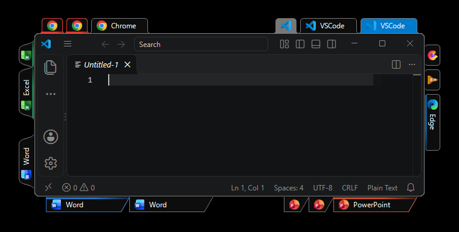


WindowTabs は、あらゆるウィンドウをタブユーザーインターフェース(UI)で管理することができる Windows の操作性を拡張するツールです。

<details>
<summary>WindowTabs の説明をもっと見る</summary>

### WindowTabs で Windows の操作性を大きく高めていただきたいです。

WindowTabs は Windows の操作性を大きく高めるツールです。

スマートフォンやタブレット端末でブラウザ閲覧やエンターテイメントを楽しめる時代に、みなさんは、Windows PC を使っているということは、それは何か創造的な作業をされているんだと思います。例えば、経理、お客様対応、プレゼン作成、経営管理、法的事務、医療業務の電子カルテ操作、動画編集、イラスト作成、あるいはソフトウェア開発、など。

そのような作業を日々行っていて Windows の操作性を向上させたいと思っている方にこそ、WindowTabsを使って操作性を作業効率を高めていただきたいと思っています。そのようなニーズに応えられるような機能を作りこんでバージョンを重ねてきました。

### なぜタブUIなのか

ブラウザを日々使っていると感じるように、タブUIは非常に直感的で人間に心地のよいUIです。

WindowTabs を導入することでブラウザと同様の操作性を Windows にもたらします。使っていただけると、とても便利です。てきぱきと仕事をこなすために重要な操作性と感じられると思います。目的の作業を行うためにウィンドウをいろいろ切り替えると思いますが、その際の操作コストが下がり目的に集中することができます。

### 以前に Microsoft が試作していましたが頓挫しました。

Microsoft も、以前に Windows の OS の機能拡張の試作として Sets という機能で、ウィンドウのすべてをタブ管理することを目指していたことがありました。
ですが、中止になっています。正確な理由はわかりませんので推測ですが、OS の内部に組み込むには過去の互換性などで難しすぎ、複雑さのわりにメリットが薄いと判断された、というところでしょう。

頓挫してしまいましたが、その目指す方向は素晴らしかったと思います。
実際に、WindowTabsを日常で使っていると、きわめて快適にウィンドウ切り替え操作ができて作業効率があがるからです。
WindowTabs は、OS の内部には組み込まれない形で、ほとんどどのようなウィンドウでもタブ化できるという優れたタブUIを実現しています。

### ss_版の作者の私 satoshi-yamamoto について

私は WindowTabs がオープンソースになる前から WindowTabs の有料ユーザーでタブUIをとても気に入って使っていました。昔から、この操作性が多くの人に広がってくれたらうれしいなと思っていましたし、さまざまな同種のソフトウェアも試してきました。

ですので、オープンソースで WindowTabs を改良して他の方に届けることができる機会が得られたことは、とても嬉しいです。

「より多くの方へ効率よい操作性を提供するにはどうしたらいいか、言い換えると、どうすれば多くの方がより仕事を素早く完了させるようにできるだろうか」ということを考えて、WindowTabs を少しずつ改善していっています。

### 使い方

個人個人のユーザーの Windows の使い方が様々であるように、ユーザーひとりひとりに WindowTabs の便利な使い方がありそうな気はしますが、代表的には次のような使い方がありそうです。

- Chrome と Edge と Firefox、そしてそれぞれのシークレットモード/プライベートモードのウィンドウを、すべて1つのブラウザウィンドウとして操作する
- 複数のExcel、複数のWordやPowerPointを1つのオフィスアプリのウィンドウとして管理する。

私(satoshi-yamamoto)はソフトウェア開発者で、普段の仕事ではWebアプリケーションを作っています。ブラウザで絵をかいたりするツールや、ブラウザで動くカーナビや、ビジネスチャットツールを作ってきました。

私は複数の VSCode、Visual Studio、Terminal、WinMerge、ファイラー、画像ビューワー、Excel、ブラウザを WindowTabs でまとめ、各ディスプレイの左右にスナップしています。タブUIを備えたアプリであっても、それをウィンドウ単位で管理できるので、タブの多段階管理を行っていて、同じプロジェクトのタブを同色にすることで、非常に多くのウィンドウを苦労なく管理することができます。

### version ss_ の強化点

WindowTabs version ss_... では、ウィンドウのタブ管理に加えて、上下左右へのスナップや別ディスプレイへの移動を1アクションで実行できます。Windows 標準のスナップ機能よりもより多くの機能を持つスナップ機能をもたせています。1アクションでドラッグ&ドロップせずにウィンドウ配置を切り替えられます。これは特にマルチディスプレイ環境で便利です。

### まわりの方にも勧めていただけたら、うれしいです

たくさんのウィンドウを切り替えて作業する方がいたら、ぜひ「WindowTabs を使ってみたら？」と勧めていただけたら嬉しいです。使って初めて分かる便利さがあります。

私は、自分が使いたいから作っているだけではあるのですが、それでも他の人の役に立てて、少しでもいい影響を届けることができれば、ソフトウェア開発者として非常にうれしいです。使ってくださっているユーザーの皆様に感謝しています。

何かご意見ありましたら、GitHub Issues に投稿いただけますとうれしいです。

</details>

<br />

私が作成しているこのバージョン (ss_yyyy.mm.dd) は payaneco 氏のリポジトリからフォークし、leafOfTree 氏のコード実装の一部が組み込まれています。メンテナンスは、[Satoshi Yamamoto (@standard-software)](https://github.com/standard-software) が行っています。

<details>
<summary>フォーク元の系譜、プロジェクトの経緯について、もっと見る</summary>

元々は Maurice Flanagan 氏によって2009年に開発され、当時は無料版と有料版が提供されていました。開発者は現在、このユーティリティをオープンソース化しています。

- https://github.com/mauricef/WindowTabs (404 Not Found)

redgis 氏がフォークし、VS2017 / .NET 4.0 に移行しました。

- https://github.com/redgis/WindowTabs

medlir 氏がコードを配置しています。
- https://github.com/medlir/WindowTabs

コミットログをみると、Mossy Flanagan 氏が初期のコミットを行っています。
- https://github.com/mossy-xyz

payaneco 氏が medlir/WindowTabs のコードをフォークしました。
- https://github.com/payaneco/WindowTabs
- https://github.com/payaneco/WindowTabs/network/members
- https://ja.stackoverflow.com/a/53822

leafOfTree 氏も様々な改良を加えたフォークを作成しています:
- https://github.com/leafOfTree/WindowTabs
- https://github.com/leafOfTree/WindowTabs/network/members

</details>

## 目次
- [バージョン](#バージョン)
- [ダウンロード](#ダウンロード)
- [インストール](#インストール)
- [使用方法](#使用方法)
- [機能](#機能)
- [設定](#設定)
- [ソースからビルド](#ソースからビルド)
- [リンク](#リンク)
- [ライセンス](#ライセンス)
- [コメント](#コメント)

## バージョン

最新のバージョン: **ss_2026.10.25_next3**

詳細は [version_Japanese.md](version_Japanese.md) を参照してください。


## ダウンロード

**対応している OS:** Windows 10、Windows 11

<a href="https://github.com/standard-software/WindowTabs/releases"></a>

[releases](https://github.com/standard-software/WindowTabs/releases) ページからダウンロードできます。

## インストール

- **WtSetup.msi** - インストーラー版。実行してウィザードに従ってください (既定: `Program Files\WindowTabs`)
- **WindowTabs.zip** - ポータブル版。任意の場所に展開し、`WindowTabs.exe` を実行してください


## 使用方法

- トレイアイコンの右クリックで「設定」を開き、「プログラム」タブでタブ化する対象を選びます。
- タブをドラッグ&ドロップしてグループ化し、右クリックで各種操作を行います。

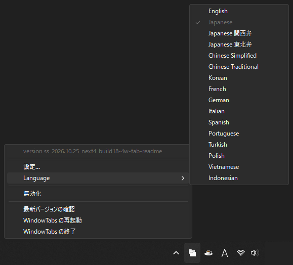

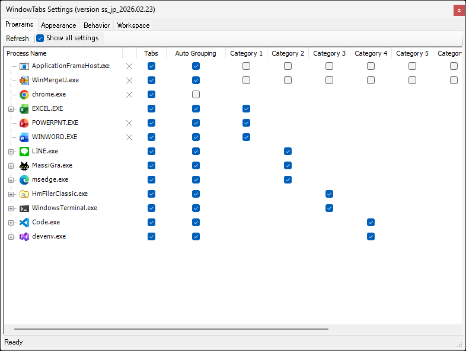

## 機能

### 複数タブ選択

- Ctrl + クリックで選択/選択解除、Shift + クリックでアクティブタブからの範囲選択。
- 選択中は、コンテキストメニューとドラッグ操作が選択全体を対象に動きます。

### タブのドラッグ&ドロップ
- 同じグループ内で順番を変更 (複数選択時は、連続している部分が動きます)
- 新規ウィンドウに分割、別グループに連結 (複数選択時は、選択したタブ全体が一緒に動きます)

### タブのコンテキストメニュー

```
対象タブ : (タブ名) : (N)タブのグループ — メニューの対象タブとタブグループのタブ数を示す表示専用の項目 (選択不可)
---
新しいタブ : (exe名) 起動
  このタブの右
  ---
  位置指定 (「位置移動」と同じサブメニュー)
  ---
  他のタブグループに連結
---
位置移動
  左スナップ / 右スナップ / 上スナップ / 下スナップ
  ---
  スナップ 90% / 70% / 50% / 30% それぞれ
    左 / 右 / 上 / 下
    左上 / 右上 / 左下 / 右下
    中央 / 水平方向に中央 / 垂直方向に中央
  ---
  スナップ ディスプレイ全体
  スナップ デスクトップ全体 (マルチディスプレイ時のみ)
  ---
  移動
    左端 / 右端 / 上端 / 下端
    左上 / 右上 / 左下 / 右下
このグループを他のタブグループに連結 (サブメニューで連結先の他のタブグループを列挙)
---
このタブの分離
  位置指定 (「位置移動」と同じサブメニュー)
  ---
  他のタブグループに連結
---
タブを閉じる
  このタブを閉じる
  ---
  左側の{N}タブを閉じる
  右側の{N}タブを閉じる
  ---
  上タブのこのタブ以外の{N}タブを閉じる
  上タブのすべてのタブ({N}タブ)を閉じる（右クリックしたタブの辺の名前）
  すべてのタブ({N}タブ)を閉じる
---
タブグループの動作
  ウィンドウの移動と上端リサイズを禁止
  スナップ時と移動時にタブの分の余白をあける
タブの配置
  このタブを左寄せにする
  このタブを右寄せにする
  ---
  上タブのすべてのタブを左寄せ
  上タブのすべてのタブを右寄せ
タブの方向
  このタブの方向を変更（複数選択時は「選択した{N}タブの方向を変更」）
    上タブ / 左タブ / 右タブ / 下タブ
  上タブのすべてのタブの方向を変更（右クリックしたタブの辺の名前）
    上タブ / 左タブ / 右タブ / 下タブ
  すべてのタブの方向を変更
    上タブ / 左タブ / 右タブ / 下タブ
タブのピン止め
  このタブをピン止め
  このタブのピン止めを外す
  ---
  上タブのすべてのタブをピン止め（右クリックしたタブの辺の名前）
  上タブのすべてのタブのピン止めを外す
  ---
  すべてのタブをピン止め
  すべてのタブのピン止めを外す
タブの色設定
  このタブの色を設定
    赤 / 青 / 緑 / 黄色 / 紫 / オレンジ / ピンク
    ---
    (同じ7色の下線バリエーション)
    ---
    (同じ7色の枠線バリエーション)
  このタブの色設定を解除
  ---
  すべてのタブの色設定を解除
タブ名の編集
  このタブの名前を変更 : (タブ名)
  このタブの名前をリセット : (リセット後のタブ名)
---
システム
  (exe名) のパスをコピー
  ウィンドウタイトルをコピー : (タイトル)
  ---
  (exe名) のフォルダを開く
  このプロセスの強制終了
設定...
```

「{辺}のこのタブ以外の{N}タブを閉じる」は右クリックした辺だけが対象で、対象が0ならDisabledです。全タブが同じ辺にあるときは辺の名前を省略します。

「{辺}のすべてのタブ({N}タブ)を閉じる」は「すべてのタブ({N}タブ)を閉じる」の直前にあり、同じ閉じる処理で右クリックした辺のタブだけを閉じます。全タブがその辺にあるときは非表示です。辺単位のピン止めも同じ条件で非表示になります。一括の寄せと辺単位の方向変更は表示したままで、グループ全体の方向変更は無効になります。

複数選択時には、個別タブ向け項目が「選択した{N}タブ...」に変わります。右クリックしたタブが選択に含まれていない場合は「選択した{N}タブ+対象タブ...」になり、「このタブ以外」を閉じる項目は「選択していない{N}タブを閉じる」になります。単独タブを基準にする項目は Disabled になります。

### 新しいタブ (新規起動)

- 同じ exe を新規起動し、そのタブの右・指定位置の新しいウィンドウ・他のタブグループに配置できます。

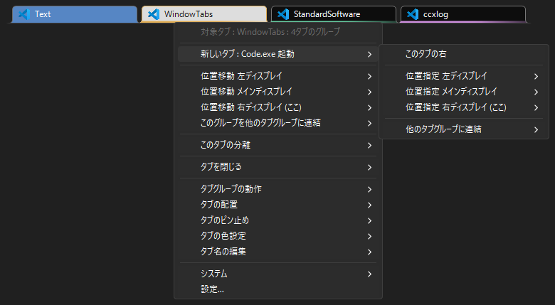

### 位置移動

- スナップは幅・高さを維持して画面端へ移動し、% 指定時はディスプレイに対する比率でサイズを変えます。画面端や四隅への移動、ディスプレイ・デスクトップ全体への最大化もできます。
- 「サイズ」でグループのウィンドウ外形を一般的な解像度（物理ピクセル）に変更できます。作業領域に収まらないサイズは選択できません。
- マルチディスプレイ時は、位置移動系のメニューがディスプレイごとに出ます (例:「位置移動 左ディスプレイ」)。現在のディスプレイには「(ここ)」が付き、他のディスプレイには「このディスプレイと同じ位置」が先頭に付きます。

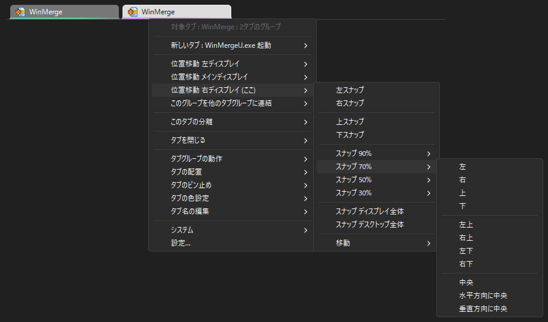

### このグループを他のタブグループに連結

- 現在のグループのタブをすべて、他のタブグループに連結します。
- 連結先のタブグループは、位置の左から右の順に並び、ディスプレイ名とタブ数が付きます。
- 他の仮想デスクトップにあるタブグループも、デスクトップごとの項目から選べます ([仮想デスクトップをサポート](#仮想デスクトップをサポート))

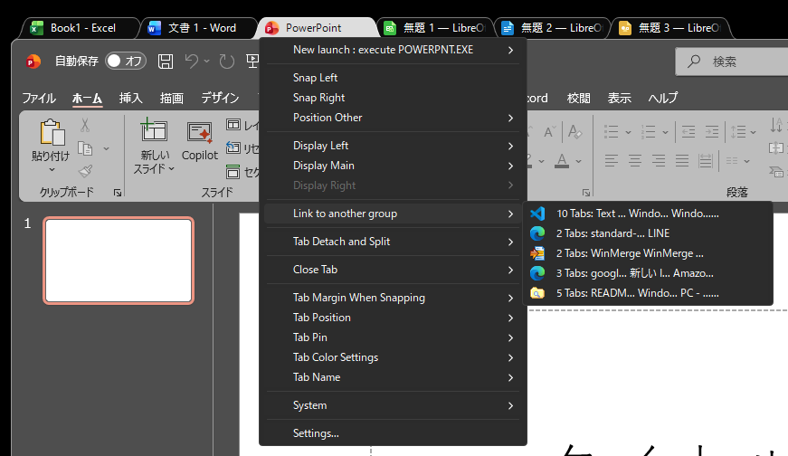

### タブの分離

- 分離したタブを、指定の位置へ移動したり、他のタブグループに連結できます。
- まとめて分離するときは、先に [複数タブ選択](#複数タブ選択) を行ってから「選択した{N}タブの分離」を実行します。

### タブを閉じる

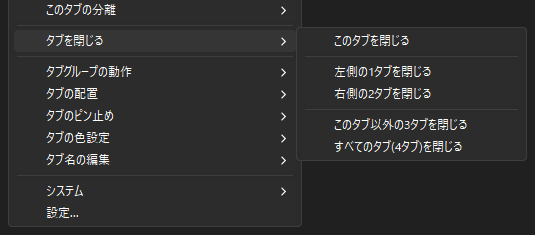

### タブの配置

- タブごと、選択したタブ、または右クリックした辺の全タブ一括で左寄せ・右寄せを設定できます。一括操作の文言には右クリックした辺の名前（上タブ・左タブなど）を表示します。左右の辺では上寄せ・下寄せになります。
- タブをドラッグしても左寄せ右寄せを変更できます。
- 設定[スナップ時と移動時のタブの寄せ]により、スナップ・移動したとき、同じ辺のタブの寄せがそろっていれば、上・下タブは左右の成分、左・右タブは上下の成分に合わせて自動で寄せることもできます。四隅にも対応します。

### タブの方向

- このタブ／選択したタブ、右クリックした辺の全タブ、グループ全体のタブを、使用する設定の辺へ移動できます。全タブが同じ辺にあるときは、グループ全体の項目が無効になります。
- 使用する辺が1つだけのときは、メニューを表示しません。移動先は四辺とも表示し、使用しない辺と対象の全タブがすでにある辺は灰色になります。
- 辺を移るときは寄せとピン止めを保ち、左寄せと上寄せ、右寄せと下寄せが相互に対応します。各寄せ・ピン止め区分の中では移動元の相対順を保ち、移動先の既存タブの後ろへ追加します。

### ピン止めタブ

- ピン止めタブは、アイコンのみ、または幅を指定してピン止めボタン付きで表示できます。
- このタブ／選択したタブ、名前を表示した辺のすべてのタブ、グループ全体のすべてのタブをそれぞれピン止め・解除できます。全タブが同じ辺にあるときは重複する辺単位の項目を隠し、状態が変わらない項目は無効になります。
- 複数選択は既存のアクティブタブ・選択タブ・右クリックしたタブを対象にします。文言も既存の選択数表示を保ち、対象タブを追加した場合は別に示します。
- どの辺でも寄せの区分ごとにピン止めが先頭側、通常タブがその後に並び、既存の並び順の規則を維持します。

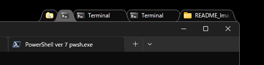
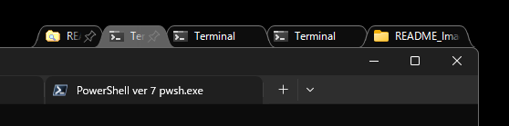

### タブのカラー

- 背景・下線・枠線でタブを色分けできます。

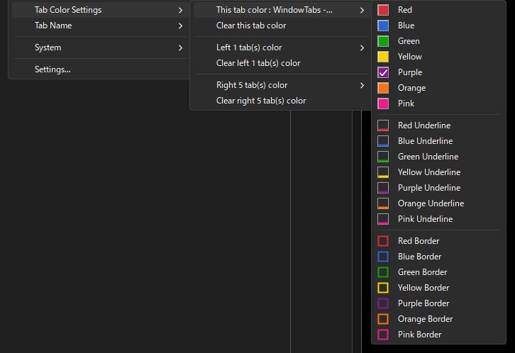

### ダークモード / ライトモード

- タブとトレイアイコンのコンテキストメニュー、設定ダイアログをダークモードにできます。

### マルチディスプレイと高 DPI をサポート

- 拡大率の異なるディスプレイ間でも、タブ・設定画面・確認ダイアログの表示サイズが追従。125% / 150% / 175% などでも鮮明に描画し、ホバー・クリック位置も表示に一致
- ドロップ時にウィンドウがディスプレイのサイズを超えてしまう問題を防止

### 仮想デスクトップをサポート

- タブグループは仮想デスクトップをまたいで 1 つです。別のデスクトップにあるウィンドウのタブは半透明で表示します
- 半透明のタブをクリックすると、そのデスクトップへ切り替わります
- 今のデスクトップにウィンドウが 1 つもないタブグループは表示しません
- 「他のタブグループに連結」のメニューには、他のデスクトップのタブグループもデスクトップごとに並びます。連結してもデスクトップは切り替わりません
- WindowTabs の再起動時に、すべての仮想デスクトップのタブグループ状態を復帰します

### UWP アプリをサポート

- UWP (Universal Windows Platform) アプリは全体を 1 つの exe として扱い、タブ化や自動グループ化に対応

### 多言語をサポート

- 英語、日本語、簡体と繁体の中国語、韓国語、フランス語、ドイツ語、イタリア語、スペイン語、ポルトガル語、トルコ語、ポーランド語、ベトナム語、インドネシア語をサポート。日本語の関西弁・東北弁版も同梱
- トレイメニューから、再起動なしで言語を変更可能

### 設定ファイル

- 利用者の設定は `WindowTabsSettings.json` に保存します
    - `%APPDATA%\WindowTabs\WindowTabsSettings.json` を使います。無いときは `WindowTabs.exe` と同じ場所の `WindowTabsSettings.json` を使うので、Exeフォルダだけを持ち運ぶポータブル版にできます
    - 設定ダイアログの [システム] タブで、使用中の設定ファイルを確かめられます。Exeフォルダへのコピー・移動と、APPDATAフォルダに戻す操作もできます
    - バックアップは `%APPDATA%\WindowTabs\` に `WindowTabsSettings.json.bak.<日付>_<時刻>` として、新しいものから 10 個残します。Exeフォルダの設定ファイルのバックアップも、`WindowTabsSettings.portable-<ID>.json.bak.<日付>_<時刻>` としてここに置くので、Exeフォルダには設定ファイルしか残りません
- `WindowTabs.exe` と同じ場所の `Settings\` に既定値があります
    - `Settings\VersionFolder.json` — 更新のたびにフォルダ名が変わるアプリを、同じアプリとして扱う設定
        - アプリごとの設定は exe のパスに結びつけて保存するので、パスの途中にバージョンの数字のフォルダがあるアプリは、アプリの更新のたびに設定が外れます。
        - その対応のために、ここに exe 名を書くと、数字とドットだけのフォルダを無視して同じアプリとして扱います
        - Store アプリは、フォルダ名にバージョンが入りますが、ここに書かなくても自動で同じアプリとして扱います
    - `Settings\FramelessWindow.json` — タイトルバーや枠を自分で描くアプリのウィンドウを、タブの対象にする設定
        - GTK3 のアプリなどは、タイトルバー・枠・最小化や最大化のボタンを Windows に任せずに自分で描きます。Windows から見ると飾りのないウィンドウで、スプラッシュ画面やポップアップと見分けられないため、通常はタブを付けません
    - `Settings\Language\FileList.json` と `Settings\Language\言語.json` — 言語ファイル
- ここのファイルはバージョンアップのたびに上書きされます。ユーザー自身で翻訳内容を変更するときは `%APPDATA%\WindowTabs\Settings\` に同名のファイルを置いてください。項目単位で同梱のものに重なります
- 言語を追加するには、`MyLanguage.json` と、それを載せた `FileList.json` を `%APPDATA%\WindowTabs\Settings\Language` に置きます
  - 訳語を直すには、同名のファイルに直したいキーだけを書きます。他は同梱のまま使われ、新しいバージョンで増えた文字列もそのまま届きます
  - `FileList.json` は同梱の一覧を丸ごと置き換えるので、トレイメニューに出す言語を絞ることもできます

### 読まなくなった設定ファイル

- `WindowTabsSettings.txt` (ss_2026.10.17 まで): 新しいバージョンの最初の起動で、中身を `WindowTabsSettings.json` にコピーします。`.txt` はそのまま残すので古いバージョンも起動できますが、コピーのあとに変えた設定は `.txt` には入りません
- 言語ファイル: ss_2026.09.02 までは `Settings\Language\` ではなく `Language\` にあり、直接編集する仕様でした。編集していた場合は `%APPDATA%\WindowTabs\Settings\Language\` へ移してください
- 余白の設定: アプリの外枠を WindowTabs が自動で見分けるようになったので、設定は不要になりました。次のファイルはもう読みません
    - `Settings\Window_Margin.json` (ss_2026.09.02 まで)
    - `Settings\WindowMargin.json` と `%APPDATA%\WindowTabs\Settings\WindowMargin.json` (ss_2026.10.03 まで)
- `WindowTabs.exe` と同じ場所にある古いファイルは、MSI では削除され、zip では残ります。`%APPDATA%` に置いたファイルはそのまま残ります。どちらも残っていて害はありません

### 最新バージョンの確認

- トレイメニューの「最新バージョンの確認」から、GitHub の最新リリースを確認できます。クリックしたときだけ行われ、自動では確認しません。
- 新しいバージョンがあれば、その場で更新できます。MSI 版はインストーラーが起動し、ZIP 版は実行ファイルを置き換えて再起動します。

### 無効にする機能

- WindowTabs を終了せずに、すべてのタブ機能を一時的に無効にできます。全画面でアプリを使うときなどに便利です。

### タブグループの永続化

- タブグループの構成は10秒ごとに保存され、WindowTabs の再起動・無効化・強制終了のあとも保持されます。
- Windows の再起動やログオフのあとも復元されます。ウィンドウハンドルが変わっていても、アプリとタイトルで同じウィンドウだと判断します。
- タブの名前・ピン・色・左右寄せ・グループ内の位置も、ウィンドウとともに戻ります。タイトルがまだ確定していないウィンドウ (ファイルを開く前の Excel など) は、本来のタイトルになってから自分の席に戻ります。
- 開き直されていないウィンドウの情報は30日、手で閉じたタブの情報は8日保持されます。

### Watchdog による自動再起動

- 万一 WindowTabs が無応答になった場合、Watchdog がフリーズを検出して自動的に再起動します。タブグループは保持・復元されます。
- 以前のバージョンでは、ディスプレイ構成の変更、スリープ復帰によってフリーズしていたため、この機能が重要な役割を果たしていましたが、現在は修正済みのため、保険としてのみ残っています。

## 設定

トレイアイコンの右クリック、またはタブの右クリックで「設定...」メニューを選びます。ダイアログを開いている間は、重複操作を防ぐためトレイ操作が無効になります。

### プログラムタブ

- **タブ**: プログラムごとにタブ機能の有効/無効を設定
- **自動グループ化**: 同じプログラムのウィンドウが自動で同じタブグループにまとまります
- **カテゴリー 1-10**: 同じカテゴリーのプログラムは、異なるアプリでも自動でグループ化されます。Word・Excel・PowerPoint を同じカテゴリーにすれば Office 系がまとまります (列は自動グループ化が有効なプログラムにのみ表示)
- 自動グループ化やカテゴリーを **ON にすると、すでに開いているウィンドウ**も、たったいま起動したかのようにまとめられます。設定が ON のまま手で引き剥がしたタブは、そのまま外に残ります。
- **すべての設定を表示**: 現在実行していないプログラムの設定も表示します。**[x]** でその設定を削除できます


### 「タブ」タブ

- **上タブ・左タブ・右タブ・下タブ**: ウィンドウの四辺それぞれのタブを、別々のページで設定します。
- **上タブを使用する**・**左タブを使用する**・**右タブを使用する**・**下タブを使用する**: 各ページの 1 行目で、その辺のタブを使うかを選びます。少なくとも 1 つは使用する必要があります。
- **下タブを同じ設定にする**: 上タブのページの設定を下タブへ写します。各ページに反対側（上と下、左と右）へ写すボタンがあります。
- 左タブ・右タブ・下タブにも、上タブと同じく、タブのスタイル・タブのサイズ (高さと最大幅)・ピン止めタブの幅・タブの重なり・寄せ・タブの外側内側・端からの距離・内側タブを隠す機能があります。左タブと右タブは、文字を回転して表示します。既定では右タブの文字は上から下へ読み、文字の下側がウィンドウ側になります。左右タブはそれぞれ「文字の下が内側／外側」を選べます。どちらも既定は内側です。

上タブのページには、次の項目があります。

- **タブのスタイル**: S字・角丸縦線・強い角丸縦線・角ばった縦線・台形・右切り欠き台形・左切り欠き台形・長方形・角丸長方形・強い角丸長方形・角ばった長方形の11種類から選べます。選ぶとすぐにタブに反映され、再起動は不要です。既定は角丸縦線です。
- **タブのサイズ**: 高さと最大幅を 1 行で調整できます。それぞれの右のボタンで既定値に戻せます。
- **ピン止めタブの幅**・**タブの重なり**・**外側タブの端からの距離**・**内側タブの端からの距離** (左右): 数値で調整できます。各項目の右のボタンで既定値に戻せます。
- **寄せ**: タブの既定の左右寄せを選びます。
- **タブの外側内側**: 「外側、ディスプレイ外にはみ出る場合は内側」(既定) または「常に内側」を選択。
- **内側タブを隠す機能**: 各辺のページで、内側タブを隠す方法と待ち時間を個別に設定できます。左・右・下タブで自分の値を保存していない項目は、上タブの現在の値に従います。

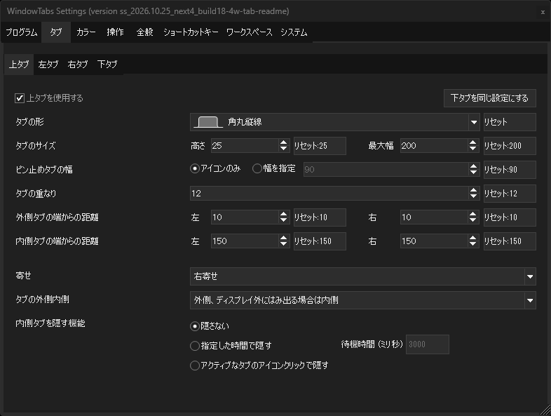
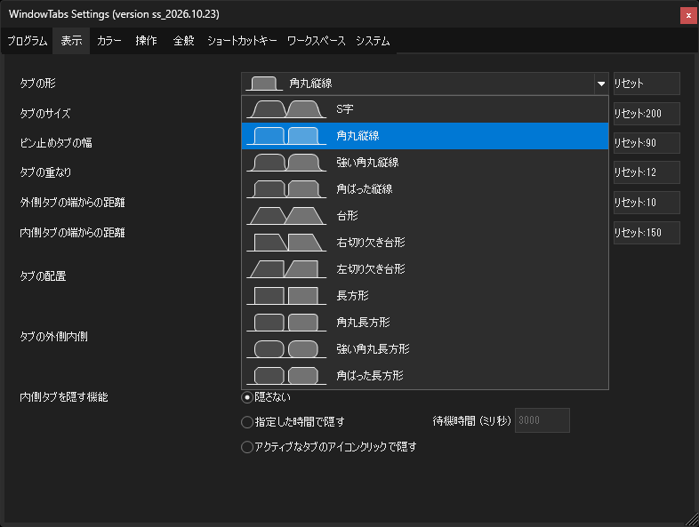

### カラータブ

- **ダークモード**: メニューと設定画面をダークモードにします。
- **タブカラーテーマ**: 既定のテーマから選ぶか、色を編集して名前を付けて保存できます。クリップボード操作で、テーマをテキストとして書き出し・読み込みできます。

よいカラーテーマを作成された方は、ぜひ [GitHub Issues](https://github.com/standard-software/WindowTabs/issues) に投稿してください。既定のカラーテーマとして組み込ませていただく場合もあります。

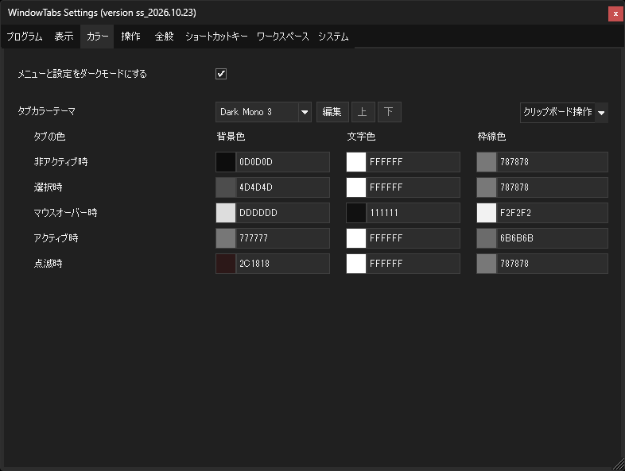
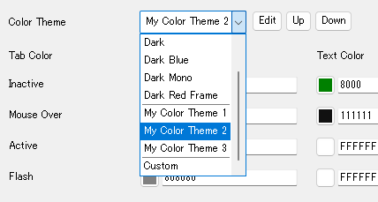
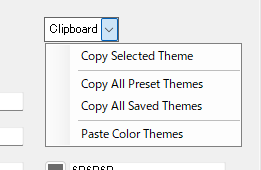

### 操作タブ

- **タブを閉じるボタン**: 「アクティブなタブのみ表示」(既定)・「すべてのタブに表示」・「表示しない」から選べます。閉じるボタンはマウスを重ねたときだけ表示されます。
- **ピン止めタブのピンボタン**: 「アクティブなタブのみボタン配置、他はアイコン表示のみ」(既定)・「すべてのタブにボタン」・「アイコン表示のみ」から選べます。アイコンはピン止め状態を示す表示で、押せません。
- マウスを重ねたタブをアクティブにするかを設定できます。
- **ウィンドウの移動と上端リサイズを禁止**: タイトルバーのドラッグでの移動と、上端からのサイズ変更を止めます。左右と下端のサイズ変更は可能です。これを変更するとすべてのタブグループに反映されます。
- **スナップ時と移動時のタブの寄せ**: 同じ辺のタブの寄せがそろっているとき、スナップ (x% 含む)・移動の方向に合わせ、上・下タブは左右、左・右タブは上下に寄せます。四隅にも対応します。「変更しない」も選択可能。
- スナップ時と移動時にタブの分の余白を残すかを選べます。移動では、位置を作業領域内に収める場合も含め、実際にタブがある外側の辺に余白を確保します。常に内側に置く辺には余白を設けず、上タブだけのグループは従来の上側余白を維持します。同じ画面内の移動では大きさを変えず、別の画面へは作業領域に対する大きさの比率を保ちます。タブを引き離した位置でスナップするかも選べます。

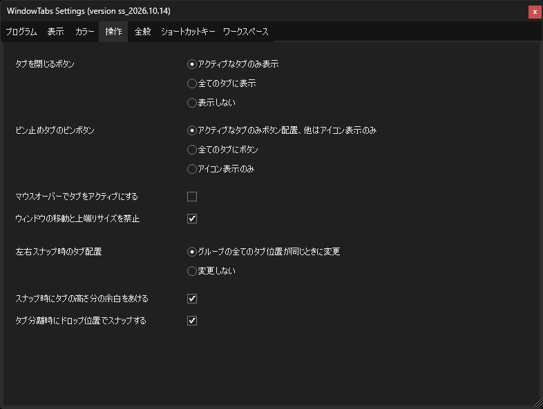

### 全般タブ

- 起動時に実行するか、すべてのプログラムで既定でタブを有効にするかを設定できます。
- **タブグループのタスクバーボタンをまとめる**: ウィンドウごとのタスクバーボタンを、タブグループごとに 1 つにまとめます (既定はオフ)。すべてのデスクトップに表示するウィンドウは、表示中のデスクトップのボタンに入ります。
- **非アクティブなグループのタブを半透明にする**: 操作していないタブグループのタブを、透明度 50% で表示します。マウスを重ねている間は元の濃さに戻ります。別の仮想デスクトップにあるウィンドウのタブも透明度 50% なので、両方が重なるタブは、さらに薄く (透明度 75%) 表示されます。
- 全画面ウィンドウのタブ、ウィンドウ移動中のタブを隠すかを選べます。

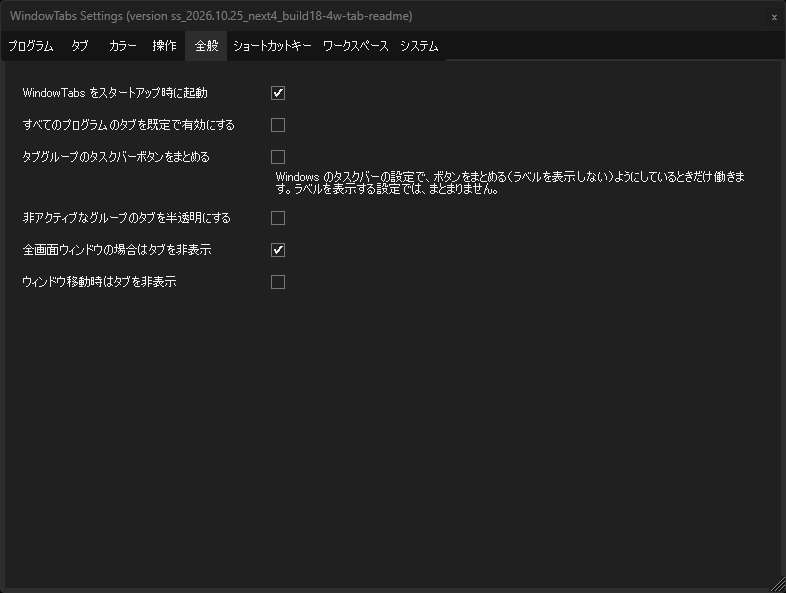

### ショートカットキータブ

- タブ1～9の選択、前後のタブへの切り替え、新規タブ追加のキーを設定できます。数字キーは Ctrl+1～9・Alt+1～9 または個別指定で、対象ウィンドウの操作中のみ有効です。

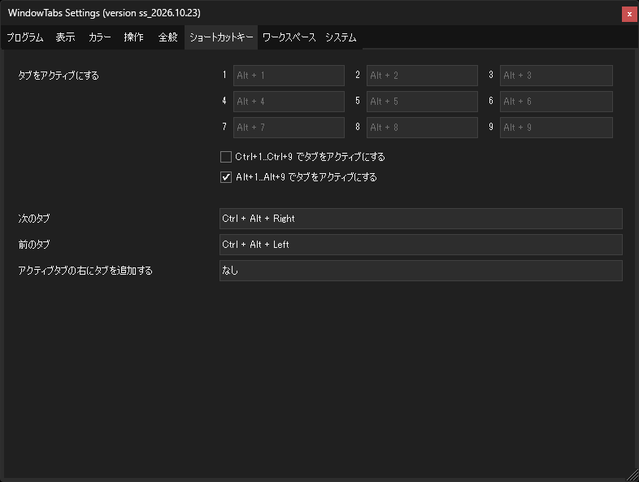

### ワークスペースタブ

- タブグループの配置と、タブの装飾・ピン・名前・寄せを保存・復元できます。
- [新規] は、今のデスクトップのタブグループとタブを保存します。仮想デスクトップが複数あるときは「現在のデスクトップのタブ」と「すべてのデスクトップのタブ」を選べます
- [復元] は、タブグループの構成と位置を戻します。ウィンドウを別の仮想デスクトップへ移すことはしません。各ウィンドウは今あるデスクトップのままタブグループに入り、別のデスクトップにあるものは半透明のタブになります

### システムタブ

- APPDATAフォルダ、Exeフォルダ、使用中の設定ファイルを表示します。[開く] でフォルダを開きます。
- **設定ファイル操作**: [Exeフォルダにコピー]・[Exeフォルダに移動]・[APPDATAフォルダに戻す] で、Exeフォルダだけで動くポータブル版を作ったり、元に戻したりできます。[設定ファイル](#設定ファイル) も見てください。

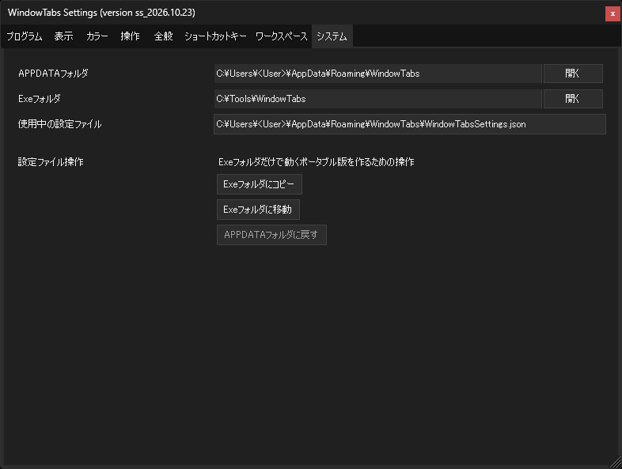

## ソースからビルド

### 前提条件

- Visual Studio 2026 Community Edition
- WiX Toolset v3.11 またはそれ以降 (MSI インストーラー版のビルド)

### ビルドスクリプト

プロジェクトのルートの **build_release.bat** で、MSI インストーラー版とポータブル ZIP 版の両方をビルドできます。

- 出力: `exe\installer\WtSetup.msi`、`exe\zip\WindowTabs.zip`

## リンク

### 英語のリソース

- WindowTabs - Download  
  https://www.softpedia.com/get/Desktop-Enhancements/ssWindowTabs.shtml

### 日本語のリソース

- WindowTabs のダウンロード・使い方 - フリーソフト100  
  https://freesoft-100.com/review/windowtabs.html

- どんなウィンドウもタブにまとめられる「WindowTabs」に日本語派生プロジェクトが誕生（窓の杜） - Yahoo!ニュース  
  https://news.yahoo.co.jp/articles/523e4c5b9db424bb1edfc582d647c1624a9b7502 (404 Not Found)

- どんなウィンドウもタブにまとめられる「WindowTabs」に日本語派生プロジェクトが誕生 - 窓の杜  
  https://forest.watch.impress.co.jp/docs/news/2067165.html

- WindowTabs のダウンロードと使い方 - ｋ本的に無料ソフト・フリーソフト  
  https://www.gigafree.net/utility/window/WindowTabs.html

- C# - WindowTabs というオープンソースを改良してみたいのですがビルドができません。何か必要なものがありますか？ - スタック・オーバーフロー  
  https://ja.stackoverflow.com/questions/53770/windowtabs-というオープンソースを改良してみたいのですがビルドができません-何か必要なものがありますか

- 全Windowタブ化。Setsで頓挫した夢の操作性をオープンソースのWindowTabsで再現する。 #Windows - Qiita  
  https://qiita.com/standard-software/items/dd25270fa3895365fced

## ライセンス

このプロジェクトはオープンソースであり、MIT ライセンスに基づいています。

## コメント

何か要望や問題がありましたら、GitHub Issues またはメールでお問い合わせください: `standard.software.net@gmail.com`

Issues の方がすぐに気が付きやすいと思います。
